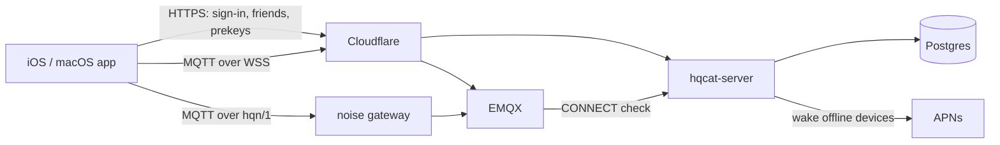

# hqchat

An end-to-end encrypted messenger with post-quantum key agreement: HQC-256 for
every key exchange, a KEM double ratchet with prekeys for forward secrecy, and
a server that moves ciphertext it cannot read.

macOS and iOS clients, one TypeScript server, EMQX for messaging, Postgres for
state, Cloudflare in front. **Version 3.0.0.** Text messages, presence, the
friend graph, reporting and blocking; no calls, attachments or voice notes.

Free for every account: no paid tier, no subscription, no in-app purchase.
Donations are taken on the website, grant nothing and are bound to no account.
Everything is here: the apps, the server and the infrastructure. The server
and infrastructure are AGPL-3.0 and free to deploy; the apps are published to
be read and checked, not reused ([LICENSING.md](LICENSING.md)).

## How it fits together



REST for who you are and who you talk to; MQTT for the conversations. The
server sees the graph, topic names, sizes and timing, never plaintext.

- [Architecture overview](docs/architecture/overview.md)
- [Authentication](docs/architecture/auth-flow.md) · [A message end to end](docs/architecture/message-flow.md)
- [The encryption protocol](docs/architecture/e2ee-protocol.md) · [Transports and the broker](docs/architecture/transport.md) · [Topic policy](docs/architecture/emqx-acl.md)

## The repository

| Path | What lives there |
|---|---|
| `apps/apple/` | Xcode project: macOS and iOS targets over shared Swift sources, test slices, `verify.sh` |
| `apps/site/` | Cloudflare Worker: the website, the crypto write-up, legal pages, the donate page |
| `services/server/` | the server, the hqn/1 gateway, the reference TypeScript client and the helper bot built on it |
| `core/` | the Rust core: HQC, the protocol, the client engine, and its bindings for Node, Swift and Kotlin (not wired into the apps or the server yet; see [multiplatform](docs/architecture/multiplatform.md)) |
| `native/hqc/` | the HQC-256 wrapper (C), built from a pinned upstream commit into the Rust core (every platform) and the standalone Nix package |
| `infra/environments/` | one JSON file per environment: domain, region, sizes, non-secret configuration |
| `infra/terraform/` | one environment from nothing: network, droplets, database, firewalls, DNS, the Worker |
| `infra/nixos/` | the hosts: NixOS modules per role, the disk image, the host agent, the two-VM stack test |
| `infra/emqx/` | the broker's configuration and ACL |
| `infra/scripts/` | the deploy steps |
| `.github/workflows/` | `ci.yml` on every pull request, `deploy.yml` (the one-click Deploy) |
| `docs/` | architecture, runbooks, product |

## Getting started

Everything below runs inside `nix develop`, which pins every tool.

**Apple apps** (Xcode 26+):

```bash
open apps/apple/HQChat.xcodeproj           # schemes: HQChat (macOS), HQChat iOS
bash apps/apple/tests/run.sh               # the Swift suites, no Xcode target needed
bash apps/apple/verify.sh                  # the full Apple gate: the core package, builds, suites, UI tests
```

`verify.sh` runs on a Mac, not in CI (macOS runners cost ten times a Linux one).

**Server** (Node 22):

```bash
cd services/server && npm ci && npm run test:unit
scripts/check.sh lint|unit|integration|scenarios|infra       # each CI layer, from the repo root
bash services/server/test/scenarios/run-local.sh             # the full stack locally (needs Docker)
```

**Deploying** is the **Deploy** workflow with an environment name. It builds,
provisions from an empty DigitalOcean account if needed, releases and verifies;
see the [deploy runbook](docs/runbooks/deploy.md). Your own server needs only
its own environment file; the app joins it from a profile's home-server
setting, no rebuild. No secret is committed.

## Where to look next

| If you are… | Start with |
|---|---|
| a **backend** engineer | [message flow](docs/architecture/message-flow.md) · [protocol](docs/architecture/e2ee-protocol.md) · [`services/server/README.md`](services/server/README.md) |
| an **Apple** engineer | [user journey](docs/product/user-journey.md) · `apps/apple/HQChat/Services/ChatStore.swift` |
| a **designer** | [design system](docs/product/design-system.md) · [user journey](docs/product/user-journey.md) |
| **operations** | [deploy](docs/runbooks/deploy.md) · [debugging](docs/runbooks/debugging.md) · [moderation](docs/runbooks/moderation.md) |
| **security** | [security policy](SECURITY.md) · [pentest scope](docs/pentest-scope.md) · [protocol](docs/architecture/e2ee-protocol.md) |

## Security

Compromising the server costs metadata and the graph, not plaintext; the
remaining risk is the device itself and the first key exchange with a new
contact. Report a vulnerability as [SECURITY.md](SECURITY.md) describes, not in
a public issue.

## Licence

The server, the infrastructure and everything outside `apps/apple/` are
[AGPL-3.0](LICENSE). The Apple apps are [PolyForm Strict 1.0.0](apps/apple/LICENSE.md):
readable, buildable for noncommercial use, not modifiable or redistributable.
See [LICENSING.md](LICENSING.md) and [TRADEMARK.md](TRADEMARK.md).
