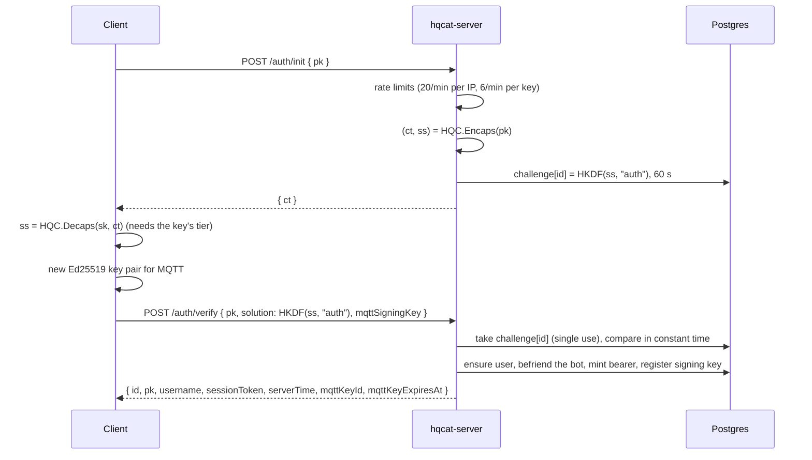

# Authentication

How a client goes from holding a private key to a live MQTT session. There is
no password: an identity is an HQC-256 key pair generated on the device, and
signing in means proving it can decapsulate a ciphertext addressed to its
public key.

## Identity

- **Key pair:** HQC-256 (public key 7,237 bytes), generated on the device from a
  32-byte random seed that is never stored. The secret key goes into the
  Keychain behind the profile's protection tier.
- **Client id:** `id = sha256(lowercase hex of the public key)`, 64 hex
  characters. Every topic, route and graph row names a client by its id. An id
  commits to its key (anyone can check a key against it) and proves nothing on
  its own (anyone holding the key can compute it).
- **Handle:** an optional username, 3–32 characters of `[A-Za-z0-9_]`, unique
  case-insensitively, with reserved names refused. Claimed after the first
  sign-in with `POST /username`.

## Sign-in



- The server keeps only the expected proof, never `ss`, so `/auth/init` is not a
  decryption oracle.
- Five failed proofs against one key within 15 minutes raise an alert; there is
  no lockout, which would let anyone lock anyone out.
- The first successful sign-in creates the account and befriends it to the
  deployment's bot.

## Sessions

| Credential | Form | Lifetime | Stored server-side as |
|---|---|---|---|
| REST bearer | 32 random bytes, hex | 1 hour idle (sliding), 30 days absolute | `sha256(token)` |
| MQTT signing key | Ed25519, private half in memory only | 12 hours; the two newest per client are kept | the public key and a 16-byte key id |

`POST /auth/refresh` (bearer) registers a new signing key without a new KEM
challenge, so it costs no biometric prompt. The client refreshes when less than
two minutes remain. A 401 on the bearer means a full sign-in.

## MQTT CONNECT

The CONNECT carries `username = clientid = id` and a password that is a fresh
proof each time:

```
signed   = "hqchat-mqtt-connect/1" 0x00 clientid 0x00 keyId 0x00 ts 0x00 nonce(16 bytes)
password = v1.<keyId: 32 hex>.<ts: unix seconds>.<nonce: base64url>.<Ed25519 signature: base64url>
```

EMQX posts it to `/mqtt/authn`, which checks, in order: the exact shape, that
`clientid` equals the username, the timestamp within ±60 s of the server clock
(the client offsets its clock by `serverTime`), a live signing key with that
id, the signature, and finally the nonce, which is spent only once everything
else passed and is remembered for 120 s. The answer carries `expire_at`, the
signing key's expiry, after which EMQX disconnects the client.

The push bridge connects on a separate internal listener, bound to WireGuard,
as `svc-internal` with a secret generated at process start; that listener's
hook is `/mqtt/authn/internal`.

## Transport discovery

`GET /auth/transport` returns the hqn/1 gateway (host, port and its static
public keys) when the deployment runs one. The app tries hqn/1 first and falls
back to MQTT over WSS (`wss://<domain>/mqtt`). See [transport.md](transport.md).

## Signing out and deleting

Account deletion (`POST /account/delete`) removes the user, its graph rows,
prekeys, push token, sessions and signing keys, revokes the presented bearer
and disconnects the MQTT client; reports filed against the account are kept.
On the device, deletion then removes that profile alone, with its keys and
rows; other profiles are kept. Wiping every profile is a separate, local-only
reset ([reset-local-data.md](../runbooks/reset-local-data.md)).
