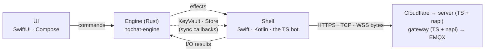
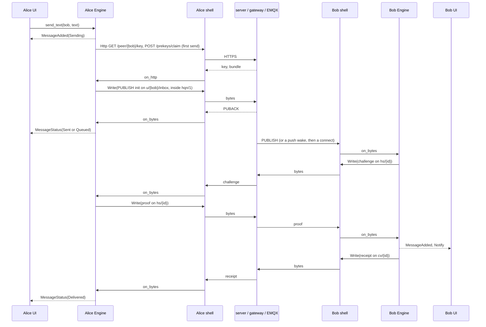

# Core wiring: from the UI to the server and back

**Status: the core is built (`core/`), and the server, the gateway and the
bot run on it (phase 2, deployment pending); the apps do not use it yet.**
Where a step below says "Today" for the server, it is what the server did
before phase 2. This document follows one message from the sender's UI, through the
server, to the recipient's UI and back as a delivery receipt. Each step names
the function that does it today, in the Apple app, the TS reference client
or the server, and the Rust function that replaces it. The design and the
plan are in [multiplatform.md](multiplatform.md).

## Who does what

| Layer | Today | With the core |
|---|---|---|
| UI | SwiftUI views over SwiftData rows (`ChatView`, `FriendListView`) | the same views, fed by `Engine` effects and reads (`history`, `friends`) |
| Client logic | Swift `Services/` (~9.5k lines); the TS client in `services/server/src/client` | `hqchat-engine`: one implementation, reached through `hqchat-ffi` (Swift, Kotlin) or `hqchat-node` (the bot) |
| Protocol | Swift (`RatchetSession`, `ConversationEnvelopeV3`, `Handshake`, `NoiseHQN`, `MQTTWireClient` …) and TS (`test/reference/protocol/*.ts`), held together by vectors | `hqchat-protocol`, checked against the same vectors |
| HQC-256 | `libhqc_wrap` via the bridging header (Swift) and koffi (TS) | `hqc` over `hqc-sys`, the same C at the same commit |
| I/O | inside the Swift services (URLSession, Network.framework) | the shell, which carries out effects: `Http`, `Open`, `Write`, `Close`, `Timer` |
| Keys at rest | `MessageKeyStore` (Secure Enclave), `AESKeyStore` (Keychain) | the shell's `KeyVault` (Secure Enclave, Keystore, TPM): `device_public_key`, `agree` |
| Server | TS, calling `src/protocol` (moved to `test/reference/` in phase 2) | TS, calling `hqchat-node` for every protocol check (built) |

The Engine is **sans-IO**: each command returns the effects to carry out, in
order, and never blocks. The shell answers each effect with a command
(`on_http`, `on_opened`, `on_bytes`, `on_closed`, `tick`). No secret key,
ratchet state or root key crosses the boundary.

## The round trip

### 0. Launch and unlock

| Step | Today | With the core |
|---|---|---|
| The app opens a profile | `HQChatApp` → `AppState` → `ChatSession.configure` | the shell builds `Engine::new(config, vault, store)` |
| A new identity | `ProfileManager` generates the seed and keys, `AESKeyStore` stores the secret key | `Engine::create_identity` → `Core::create_identity`: `KeyVault::create`, `hqc::keypair_from_seed`, a random data key, `persist::seal_device` of the state |
| Unlock | `MessageKeyGate.unlock` (LAContext), then `AESKeyStore.read` | the shell authenticates, then `Engine::unlock` → `Core::open_state`: one `KeyVault::agree` (the Secure Enclave's `SecKeyCopyKeyExchangeResult`), `persist::open_device`; then `drain_pending` opens what arrived locked |

### 1. Sign-in (UI → server → UI)

| Step | Today | With the core |
|---|---|---|
| Start | `ChatSession` → `AuthService.login` | `Engine::start` → `Core::ensure_signed_in` → `Effect::Http POST /auth/init` |
| Server challenges | `auth.ts handleInit`: `HqcWrapper.encapsulate`, `authProof` | `handleInit`: `hqcEncapsulate`, `authProof` (napi) |
| Client answers | `HQCService.decapsulate`, `AESService.authProof`, a new `Curve25519.Signing` key | `Core::on_auth_init`: `hqc::decapsulate`, `auth_proof::auth_proof`, `mqtt_proof::SigningKey::generate` → `Effect::Http POST /auth/verify` |
| Server verifies | `handleVerify`: `safeEqual`, `DB.mintSessionToken`, `signingKeyFields` | `handleVerify`: `authProofMatches` (napi); the database stays TS |
| Client adopts | `AuthService` keeps the session, `clockOffset` | `Core::on_auth_verify` (checks the id), `adopt`: token, key id, expiry, server clock offset → `on_signed_in` |
| Refresh | `AuthService` refresh path | `Core::refresh` → `/auth/refresh`; a 401 falls back to a full sign-in |
| UI | `ChatSession.state` | `Effect::Connection(Authenticating)`, then `Connecting`, `Connected`, or `ActionFailed { SignIn }` |

### 2. Connect to the broker

| Step | Today | With the core |
|---|---|---|
| Choose the transport | `ServerConfig`, `TransportSelector`, `Reachability` | `Core::connect` → `/auth/transport` → `Core::open`: hqn/1 unless it failed on this network, else WSS → `Effect::Open { Tcp \| Wss }` |
| Open the socket | `MQTTTransport` (NWConnection, URLSessionWebSocketTask with `TLSPinningDelegate`) | **the shell**, unchanged in substance: it opens what `Open` names and pins TLS for WSS |
| CONNECT | `AuthService.mqttConnectPassword` (`MQTTConnectProof`), `MQTTCodec.connect`, `NoiseHQN` msg1 | `Core::on_opened`: `mqtt_proof::sign_connect`, `mqtt::encode(Connect)` with the offline will, `HqnInitiator::write_message1` → `Effect::Write` |
| Gateway | `gateway.ts` with `protocol/noise.ts` `HqnResponder`; `decap-worker.ts` with `HqcWrapper.decapsulate` | `HqnGatewayHandshake.openMessage1`, `hqcDecapsulate` on the worker, `finishMessage1`, `writeMessage2`, `HqnTransport.open/seal` (napi) |
| EMQX authenticates | `auth.ts verifyConnect`: `parseProofPassword`, `isFreshTimestamp`, `verifyProofSignature` | `parseConnectProof`, `isFreshTimestamp`, `verifyConnectProof` (napi); the nonce store stays TS |
| CONNACK, subscriptions, presence | `MQTTService.didConnect`, `subscribeFriend`, `publishPresence` | `Core::on_bytes` (`read_message2`, `Decoder`) → `on_connected`: one SUBSCRIBE (inbox, graph; per friend `cv/`, `hs/` QoS 1, presence QoS 0), presence retained → `on_link_up` flushes the outbox |
| Keep-alive, reconnect | `MQTTWireClient` keep-alive, `AppState` backoff loop, `ChatSession` directory poll | `Core::tick` with `Effect::Timer`: PINGREQ at 60 s, directory poll at 60 s, backoff 2–30 s, CONNACK deadline 15 s |

### 3. Friends and prekeys

| Step | Today | With the core |
|---|---|---|
| Friend list | `DirectorySync`, `FriendService`, `APIClient` | `Core::sync_directory` → `/friends`, `/friends/invites` → `on_friends`, `on_invites` → `Effect::FriendsChanged`, `InvitesChanged`; the graph nudge on `u/{id}/graph` triggers it |
| Server side | `api.ts` (`isPeerId`), `emqx.ts` topic names | `isPeerId`, `conversationTopic`, `handshakeTopic` (napi) |
| Actions | `FriendService.sendFriendRequest`, accept, remove, block; `ReportSheet` | `invite`, `accept`, `remove`, `block`, `report` → `Core::friendship` / `report` |
| Prekeys | `PrekeyService.ensurePublished` | `Core::ensure_prekeys` → `/prekeys/count` → `publish_prekeys` (8, topped up at 4, medium-term weekly), secrets saved first |
| Safety number | `KeyFingerprint.safetyNumber` | `Engine::fingerprint` → `safety_number` (same digits) |

### 4. Alice sends (UI → Engine → server)

| Step | Today | With the core |
|---|---|---|
| The user taps Send | `ChatView.sendMessage` inserts a SwiftData `Message`, then `deliver` | `Engine::send_text` → `Core::send_text`: `stamp`, `put_message` (sealed under the data key), the outbox (in the sealed state) → `Effect::MessageAdded(Sending)` |
| First message: the key | `ChatSession.startSession` → `APIClient` peer key, `Friend.pin` | `Core::start_session` → `GET /peer/{id}/key` → `on_peer_key`: `PeerId::matches`, pinned |
| First message: prekeys | `APIClient` claim, `RatchetSession.startAsInitiator` | `POST /prekeys/claim` → `on_claim`: `ratchet::start_as_initiator` → `put_session` |
| Seal | `ChatSession.seal`: `RatchetSession.seal`, `ConversationFrame.header`, `AESService.encryptRaw` | `Core::seal_frame`: `ratchet::seal`, `envelope::header_bytes` (the AAD), `aead::seal_payload`, `envelope::encode`, `save_session` |
| Publish | `ChatSession.publish` → `MQTTService.sendToInbox` / `send` → `MQTTWireClient.publish` | `Core::flush` → `Core::publish`: `mqtt::encode(Publish QoS 1)`, `noise::seal_frames` → `Effect::Write` (an `init` to `u/{bob}/inbox`, the rest to `cv/{id}`) |
| Broker acknowledges | `MQTTWireClient` PUBACK → `Message.advanceDelivery(.sent/.queued)` | `Core::on_packet(Puback)` → `on_puback` → `set_status` → `Effect::MessageStatus(Sent \| Queued)` |
| Link drops first | `ReplayPolicy`, `resendUnconfirmed` | `on_link_down` marks the outbox for resending under the same ids |

### 5. Through the server

| Step | Today | With the core |
|---|---|---|
| hqn/1 | `gateway.ts` decrypts and pipes to EMQX | the same, with `HqnTransport.open` / `seal` |
| Topic policy | EMQX ACL (`infra/emqx/acl.conf`) | unchanged |
| Offline queue | EMQX persistent session | unchanged |
| Push wake | `push.ts` → `apns.ts` (content-free) | unchanged; FCM and UnifiedPush are added in phase 4 |

### 6. Bob receives (server → Engine → UI)

| Step | Today | With the core |
|---|---|---|
| Bytes in | `MQTTWireClient` → `MQTTService.deliver` | the shell → `Engine::on_bytes` → `Core::on_bytes`: Noise `decrypt`, `mqtt::Decoder`, PUBACK for QoS 1 → `on_publish`: `topics::route` |
| Locked | `InboundQueue.admit`, `PendingFrame` | `Core::keep_for_unlock`: `persist::seal_device` (needs no user), unread count → `Effect::Notify` (no content); `drain_pending` at the next unlock |
| Checks | `ConversationFrame.decodeReporting`, `ConversationRouter.handle` | `Core::on_frame`: `envelope::decode`; sender a friend, addressed to us, the right topic for the kind |
| Unproven init | `ConversationRouter.challengeInitiator` | `Core::challenge`: `handshake::init_transcript`, `Kem::encapsulate` to the sender's key, `handshake::handshake_proof` (expected), `handshake::encode` → `Effect::Write` on `hs/{id}` |
| Alice proves | `ConversationRouter.handleHandshake` / `applyHandshake` | `Core::on_handshake(Challenge)`: `hqc::decapsulate` with the identity key, `handshake_proof` bound to the init she sent |
| Bob releases | `handleHandshake` proof branch, `handleInit`, `deriveResponderSession` | `Core::on_handshake(Proof)`: `handshake::proof_matches` → `open_init`: `ratchet::start_as_responder`, `ratchet::open` with `aead::open_payload` as the only authenticator, the one-time prekey deleted, the sender's key pinned |
| Crossing inits | `resolveCollision` (`InitCollision`) | `Core::on_init`: heard from them → a message; else the lower id keeps its session, the higher yields and `resend_unconfirmed` |
| Store and show | `ConversationRouter.store`, `MessageKeyStore.wrap`, SwiftData | `Core::deliver`: `put_message` (once per id) → `Effect::MessageAdded`, `Effect::Notify` |
| Later messages | `handleMsg` | `Core::open_message` → `ratchet::open` (steps, skipped keys) |

### 7. The receipt (Bob's Engine → Alice's UI)

| Step | Today | With the core |
|---|---|---|
| Bob acknowledges | `ChatSession.sendReceipt` (inside an answered session only) | `Core::send_receipt` → `seal_frame(Kind::Receipt)` → `publish` on `cv/{id}` |
| Alice marks it | `ConversationRouter.handleReceipt` → `.delivered` | `Core::open_message(Receipt)` → `set_status(Delivered)` → `Effect::MessageStatus(Delivered)`; her pending init is retired |

### 8. At rest

| Data | Today | With the core |
|---|---|---|
| Identity, prekeys, directory | Keychain items behind the tier, SwiftData `Friend` | `state`, sealed to the device key (ECIES P-256 through `KeyVault`) |
| Ratchet sessions | `Friend.ratchetSession` (Codable) | `session/{peer}` under the data key |
| Messages | SwiftData `Message` with `MessageKeyStore` (SE-wrapped AES keys) | `msg/{peer}/{time}/{id}` under the data key |
| Frames received locked | `PendingFrame` rows | `pending/{time}/{seq}`, sealed to the device key |

Every blob is bound to its key as AAD. Opening rows the Apple app sealed
today is the importer's job (phase 3).

## The functions the core exposes

### To Swift and Kotlin (`hqchat-ffi`, uniffi)

- `Engine::new(config, vault, store)`, `create_identity`, `start`,
  `unlock`, `lock`, `tick`.
- User actions: `send_text`, `retry`, `invite`, `accept`, `remove`, `block`,
  `report`, `set_username`, `delete_account`, `register_push`.
- Reads: `history`, `friends`, `invites`, `fingerprint`.
- I/O results: `on_http`, `on_opened`, `on_bytes`, `on_closed`,
  `on_network_changed`.
- Effects: `Http`, `Open`, `Write`, `Close`, `Timer`, `NeedUnlock`,
  `MessageAdded`, `MessageStatus`, `FriendsChanged`, `InvitesChanged`,
  `PresenceChanged`, `Connection`, `TierChanged`, `Notify`, `ActionFailed`,
  `AccountDeleted`, `Dropped`, `StorageFailed`.
- What the app implements: `KeyVault` (`create`, `device_public_key`,
  `agree`, `tier`) and `Store` (`get`, `put`, `delete`, `list`).
- Errors: `CoreError` (`NoIdentity`, `NotAFriend`, `NoPrekeys`, `Locked`,
  `Vault`, `Store`, `State`, `Protocol`).

### To the server (`hqchat-node`, napi): wired in phase 2

| Export | Replaced |
|---|---|
| `hqcKeypairFromSeed`, `hqcEncapsulate`, `hqcDecapsulate`, `HQC_PUBLIC_KEY_BYTES` | `protocol/hqc.ts` (koffi) in `auth.ts`, `gateway/keys.ts`, `gateway/decap-worker.ts` |
| `authProof`, `authProofMatches` | `protocol/auth-proof.ts` in `auth.ts` |
| `parseConnectProof`, `isFreshTimestamp`, `verifyConnectProof`, `isSigningKey`, `MQTT_PROOF_NONCE_TTL_SECONDS` | `protocol/mqtt-proof.ts` in `auth.ts` (`verifyConnect`, `readSigningKey`) |
| `peerId`, `isPeerId`, `keyMatchesId`, `conversationTopic`, `handshakeTopic`, `PEER_ID_LENGTH` | `protocol/identity.ts`, `topics.ts` in `api.ts`, `emqx.ts`, `db/users.ts`, `scripts/check-push.ts` |
| `GatewayKeyPair`, `HqnGatewayHandshake`, `HqnTransport`, `hqnMsg1Length`, `hqnFrame`, `HQN_VERSION` | `protocol/noise.ts` in `gateway/gateway.ts`, `gateway/keys.ts` |
| `Engine` (software vault, directory store), with `importLegacy` | `src/client/*` for `hqcat-bot`, through `src/common/core-client.ts` |

## What goes and what stays

| Where | Deleted once the core is wired in | Kept |
|---|---|---|
| `apps/apple/HQChat/Services/` | `ChatSession` internals, `ConversationRouter`, `RatchetSession`, `DoubleRatchet`, `Handshake`, `ConversationEnvelopeV3`, `ConversationFrame`, `NoiseHQN`, `MQTTWireClient`, `MQTTService`, `MQTTConnectProof`, `MQTTTopics`, `PrekeyService`, `InboundQueue`, `AESService`, `HQCKem`, `HQCService`, `AuthService`, `DirectorySync`, `FriendService` logic, `KeyFingerprint` | an effect loop (`CoreShell`), `TLSPinning`, `PushManager`, `NotificationService`, `Reachability`, a `KeyVault` on the Secure Enclave (from `MessageKeyStore`), a `Store`, the importer, the views |
| `services/server/src/protocol/`, `src/client/` | done: no production code uses them; they moved to `test/reference/` as the independent implementation the fuzzers and scenarios drive | `src/common/core-client.ts`, the effect loop over the napi `Engine` (fetch, `net`, WebSocket) for the bot |
| `services/server/src/server/`, `gateway/` | done: the koffi loader and `HQC_LIB` | everything else, calling napi |
| `native/hqc/` | nothing (the Rust build compiles it) | all |

## Tests that hold it together

| Layer | Test |
|---|---|
| HQC | the shipped known answers (`core/hqc/tests/kem.rs`), and again through Node |
| Protocol | the shared vector files, read in place from `services/server/test/helpers/` (identity, envelope, handshake, ratchet, CONNECT proof, hqn/1), the published Noise NK vector, RFC 7748, Node's crypto, mqtt.js's encoder; hostile input to every decoder |
| Engine | two engines through a fake server and broker in Rust: the scenarios of `messaging.test.ts`, the locked queue, crossing inits, hqn/1 blocked, reconnects, history at rest |
| Bindings | Node: the vectors through the addon and the TS hqn/1 initiator against the Rust gateway; a TS state file imported into the engine; Swift: generated bindings with a CryptoKit `KeyVault` |
| Differential | `hqchat-verdict` answers the fuzzers in `services/server/test/fuzz` (envelope decode and encode, handshake, hqn/1): Rust and the TS reference agree on every verdict, AAD and field |
| Server | the unit and integration layers on the addon; the gateway driven by the TS initiator over real sockets |
| Scenarios | the local stack (`run-local.sh`): the reference client against the server, the bot on the core, an engine user talking to a reference user, and the Swift app live over hqn/1 |
| CI | `scripts/check.sh core` on every pull request |
