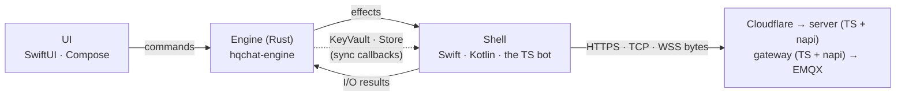
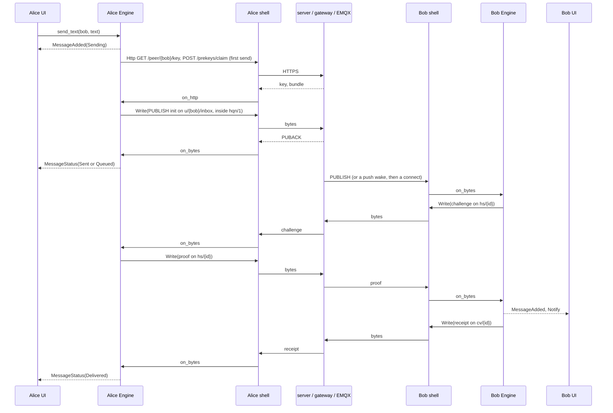

# Core wiring: from the UI to the server and back

**Status: the core is built (`core/`); the server, the gateway, the bot and
the Apple apps run on it (phases 2 and 3, on `main`; the apps ship as the
release after 3.1.1).** The "Before" column is what the server did before
phase 2 and the Apple app before phase 3, kept as the map from the old code to
the new. This document follows one message from the sender's UI, through the
server, to the recipient's UI and back as a delivery receipt. Each step names
the function that does it today, in the Apple app, the TS reference client
or the server, and the Rust function that replaces it. The design and the
plan are in [multiplatform.md](multiplatform.md).

## Who does what

| Layer | Before | With the core |
|---|---|---|
| UI | SwiftUI views over SwiftData rows (`ChatView`, `FriendListView`) | the same views, fed by `Engine` effects and reads (`history`, `friends`) |
| Client logic | Swift `Services/` (~9.5k lines); the TS client in `services/server/src/client` | `hqchat-engine`: one implementation, reached through `hqchat-ffi` (Swift, Kotlin) or `hqchat-node` (the bot) |
| Protocol | Swift (`RatchetSession`, `ConversationEnvelopeV3`, `Handshake`, `NoiseHQN`, `MQTTWireClient` …) and TS (`test/reference/protocol/*.ts`), held together by vectors | `hqchat-protocol`, checked against the same vectors |
| HQC-256 | `libhqc_wrap` via the bridging header (Swift) and koffi (TS) | `hqc` over `hqc-sys`, the same C at the same commit |
| I/O | inside the Swift services (URLSession, Network.framework) | the shell, which carries out effects: `Http`, `Open`, `Write`, `Close`, `Timer` |
| Keys at rest | `MessageKeyStore` (Secure Enclave), `AESKeyStore` (Keychain) | the shell's `KeyVault` (Secure Enclave, Keystore, TPM): `device_public_key`, `agree`, `state_secret` |
| Server | TS, calling `src/protocol` (moved to `test/reference/` in phase 2) | TS, calling `hqchat-node` for every protocol check (built) |

The Engine is **sans-IO**: each command returns the effects to carry out, in
order, and never blocks. The shell answers each effect with a command
(`on_http`, `on_opened`, `on_bytes`, `on_closed`, `tick`). No secret key,
ratchet state or root key crosses the boundary.

## The round trip

### 0. Launch and unlock

| Step | Before | With the core |
|---|---|---|
| The app opens a profile | `HQChatApp` → `AppState` → `ChatSession.configure` | the shell builds `Engine::new(config, vault, store)` |
| A new identity | `ProfileManager` generates the seed and keys, `AESKeyStore` stores the secret key | `Engine::create_identity` → `Core::create_identity`: `KeyVault::create`, `hqc::keypair_from_seed`, a random data key, `persist::seal_state` |
| Unlock | `MessageKeyGate.unlock` (LAContext), then `AESKeyStore.read` | the shell authenticates, then `Engine::unlock` → `Core::open_state`: one `KeyVault::agree` (the Secure Enclave's `SecKeyCopyKeyExchangeResult`) and `KeyVault::state_secret`, `persist::open_state`; then `drain_pending` opens what arrived locked |
| Lock | — | `Engine::lock` drops the unlocked state (zeroed on drop); the Apple shell calls it when the app goes to the background, the screen sleeps or the user switches |

### 1. Sign-in (UI → server → UI)

| Step | Before | With the core |
|---|---|---|
| Start | `ChatSession` → `AuthService.login` | `Engine::start` → `Core::ensure_signed_in` → `Effect::Http POST /auth/init { pk, origin }` |
| Server challenges | `auth.ts handleInit`: `HqcWrapper.encapsulate`, `authProof` | `handleInit`: `originOf` (the origin must be one `AUTH_ORIGINS` lists), `authChallenge` (napi): the ciphertext and the expected proof, never the secret |
| Client answers | `HQCService.decapsulate`, `AESService.authProof`, a new `Curve25519.Signing` key | `Core::on_auth_init`: `hqc::decapsulate`, `auth_proof::sign_in_proof` (bound to the origin, the key and the challenge), `mqtt_proof::SigningKey::generate` → `Effect::Http POST /auth/verify` |
| Server verifies | `handleVerify`: `safeEqual`, `DB.mintSessionToken`, `signingKeyFields` | `handleVerify`: `authProofMatches` (napi); the database stays TS |
| Client adopts | `AuthService` keeps the session, `clockOffset` | `Core::on_auth_verify` (checks the id), `adopt`: token, key id, expiry, server clock offset → `on_signed_in` |
| Refresh | `AuthService` refresh path | `Core::refresh` → `/auth/refresh`; a 401 falls back to a full sign-in |
| UI | `ChatSession.state` | `Effect::Connection(Authenticating)`, then `Connecting`, `Connected`, or `ActionFailed { SignIn }` |

### 2. Connect to the broker

| Step | Before | With the core |
|---|---|---|
| Choose the transport | `ServerConfig`, `TransportSelector`, `Reachability` | `Core::connect` → `/auth/transport` → `on_transport` (a gateway key not in `Config::hqn_pins`, when the build pins any, is refused) → `Core::open`: hqn/1 unless it failed on this network, else WSS → `Effect::Open { Tcp \| Wss }` |
| Open the socket | `MQTTTransport` (NWConnection, URLSessionWebSocketTask with `TLSPinningDelegate`) | **the shell**, unchanged in substance: it opens what `Open` names and pins TLS for WSS |
| CONNECT | `AuthService.mqttConnectPassword` (`MQTTConnectProof`), `MQTTCodec.connect`, `NoiseHQN` msg1 | `Core::on_opened`: `mqtt_proof::sign_connect`, `mqtt::encode(Connect)` with the offline will, `HqnInitiator::write_message1` → `Effect::Write` |
| Gateway | `gateway.ts` with `protocol/noise.ts` `HqnResponder`; `decap-worker.ts` with `HqcWrapper.decapsulate` | `HqnGatewayHandshake.openMessage1`, `hqcDecapsulate` on the worker, `finishMessage1`, `writeMessage2`, `HqnTransport.open/seal` (napi) |
| EMQX authenticates | `auth.ts verifyConnect`: `parseProofPassword`, `isFreshTimestamp`, `verifyProofSignature` | `parseConnectProof`, `isFreshTimestamp`, `verifyConnectProof` (napi); the nonce store stays TS |
| CONNACK, subscriptions, presence | `MQTTService.didConnect`, `subscribeFriend`, `publishPresence` | `Core::on_bytes` (`read_message2`, `Decoder`) → `on_connected`: one SUBSCRIBE (inbox, graph; per friend `cv/`, `hs/` QoS 1, presence QoS 0), presence retained → `on_link_up` flushes the outbox |
| Keep-alive, reconnect | `MQTTWireClient` keep-alive, `AppState` backoff loop, `ChatSession` directory poll | `Core::tick` with `Effect::Timer`: PINGREQ at 60 s, directory poll at 60 s, backoff 2–30 s, CONNACK deadline 15 s |

### 3. Friends and prekeys

| Step | Before | With the core |
|---|---|---|
| Friend list | `DirectorySync`, `FriendService`, `APIClient` | `Core::sync_directory` → `/friends`, `/friends/invites` → `on_friends`, `on_invites` → `Effect::FriendsChanged`, `InvitesChanged`; the graph nudge on `u/{id}/graph` triggers it |
| Server side | `api.ts` (`isPeerId`), `emqx.ts` topic names | `isPeerId`, `conversationTopic`, `handshakeTopic` (napi) |
| Actions | `FriendService.sendFriendRequest`, accept, remove, block; `ReportSheet` | `invite`, `cancel`, `accept`, `remove`, `block`, `unblock`, `report` → `Core::friendship` / `report` (a report quotes one message the friend sent, or fails visibly) → `Effect::ActionDone` or `ActionFailed` |
| Prekeys | `PrekeyService.ensurePublished` | `Core::ensure_prekeys` → `/prekeys/count` → `publish_prekeys` (8, topped up at 4, medium-term weekly), secrets saved first |
| Safety number | `KeyFingerprint.safetyNumber` | `Engine::fingerprint` → `safety_number` (same digits) |

### 4. Alice sends (UI → Engine → server)

| Step | Before | With the core |
|---|---|---|
| The user taps Send | `ChatView.sendMessage` inserts a SwiftData `Message`, then `deliver` | `Engine::send_text` → `Core::send_text`: `stamp`, `put_message` (sealed under the data key), the outbox (in the sealed state) → `Effect::MessageAdded(Sending)` |
| First message: the key | `ChatSession.startSession` → `APIClient` peer key, `Friend.pin` | `Core::start_session` → `GET /peer/{id}/key` → `on_peer_key`: `PeerId::matches`, pinned |
| First message: prekeys | `APIClient` claim, `RatchetSession.startAsInitiator` | `POST /prekeys/claim` → `on_claim`: `ratchet::start_as_initiator` → `put_session` |
| Seal | `ChatSession.seal`: `RatchetSession.seal`, `ConversationFrame.header`, `AESService.encryptRaw` | `Core::seal_frame`: `ratchet::seal`, `envelope::header_bytes` (the AAD), `padding::pad` (256-byte classes), `aead::seal_payload`, `envelope::encode`, `save_session` |
| Publish | `ChatSession.publish` → `MQTTService.sendToInbox` / `send` → `MQTTWireClient.publish` | `Core::flush` → `Core::publish`: `mqtt::encode(Publish QoS 1)`, `noise::seal_frames` → `Effect::Write` (an `init` to `u/{bob}/inbox`, the rest to `cv/{id}`); at most 128 publishes wait for a PUBACK |
| Broker acknowledges | `MQTTWireClient` PUBACK → `Message.advanceDelivery(.sent/.queued)` | `Core::on_packet(Puback)` → `on_puback` → `set_status` → `Effect::MessageStatus(Sent \| Queued)` |
| Link drops first | `ReplayPolicy`, `resendUnconfirmed` | `on_link_down` marks the outbox for resending under the same ids |

### 5. Through the server

| Step | Before | With the core |
|---|---|---|
| hqn/1 | `gateway.ts` decrypts and pipes to EMQX | the same, with `HqnTransport.open` / `seal` |
| Topic policy | EMQX ACL (`infra/emqx/acl.conf`) | unchanged |
| Offline queue | EMQX persistent session | unchanged |
| Push wake | `push.ts` → `apns.ts` (content-free) | the same, and an `init` on an offline user's inbox wakes them too (one wake per recipient per interval, over one APNs connection); FCM and UnifiedPush are added in phase 4 |

### 6. Bob receives (server → Engine → UI)

| Step | Before | With the core |
|---|---|---|
| Bytes in | `MQTTWireClient` → `MQTTService.deliver` | the shell → `Engine::on_bytes` → `Core::on_bytes`: Noise `decrypt`, `mqtt::Decoder` (a publish over 256 KiB is acknowledged and dropped, the link stays up) → `on_publish`: `topics::route`; the PUBACK goes only once the frame is written |
| Locked | `InboundQueue.admit`, `PendingFrame` | `Core::keep_for_unlock`: only frames from a friend, to us, on the right topic; bounded (64 first contacts, 1,000 frames); `persist::seal_device` (needs no user) → `Effect::Notify` (no content; a first contact names no one until its sender is proven); `drain_pending` at the next unlock |
| Checks | `ConversationFrame.decodeReporting`, `ConversationRouter.handle` | `Core::on_frame`: `envelope::decode`; sender a friend, addressed to us, the right topic for the kind |
| Unproven init | `ConversationRouter.challengeInitiator` | `Core::challenge`: `handshake::init_transcript`, `Kem::encapsulate` to the sender's key, `handshake::handshake_proof` (expected), `handshake::encode` → `Effect::Write` on `hs/{id}`; bounded per claimed sender and in total, so forged inits cost the victim no message, memory or disk |
| Alice proves | `ConversationRouter.handleHandshake` / `applyHandshake` | `Core::on_handshake(Challenge)`: `hqc::decapsulate` with the identity key, `handshake_proof` bound to the init she sent |
| Bob releases | `handleHandshake` proof branch, `handleInit`, `deriveResponderSession` | `Core::on_handshake(Proof)`: `handshake::proof_matches` → `open_init`: `ratchet::start_as_responder`, `ratchet::open` with `aead::open_payload` as the only authenticator, the one-time prekey deleted, the sender's key pinned |
| Crossing inits | `resolveCollision` (`InitCollision`) | `Core::on_init`: heard from them → a message; else the lower id keeps its session, the higher yields and `resend_unconfirmed` |
| Store and show | `ConversationRouter.store`, `MessageKeyStore.wrap`, SwiftData | `Core::deliver`: `put_message` (once per id) → `Effect::MessageAdded`, `Effect::Notify` |
| Later messages | `handleMsg` | `Core::open_message` → `ratchet::open` (steps, skipped keys) |

### 7. The receipt (Bob's Engine → Alice's UI)

| Step | Before | With the core |
|---|---|---|
| Bob acknowledges | `ChatSession.sendReceipt` (inside an answered session only) | `Core::send_receipt` → `seal_frame(Kind::Receipt)` → `publish` on `cv/{id}` |
| Alice marks it | `ConversationRouter.handleReceipt` → `.delivered` | `Core::open_message(Receipt)` → `set_status(Delivered)` → `Effect::MessageStatus(Delivered)`; her pending init is retired |

### 8. At rest

| Data | Before | With the core |
|---|---|---|
| Identity, prekeys, directory | Keychain items behind the tier, SwiftData `Friend` | `state`, sealed under P-256 ECDH with the device key (through `KeyVault`) joined with the vault's state secret |
| Ratchet sessions | `Friend.ratchetSession` (Codable) | `session/{peer tag}` under the data key |
| Messages | SwiftData `Message` with `MessageKeyStore` (SE-wrapped AES keys) | `msg/{peer tag}/{time}/{id tag}` under the data key |
| Frames received locked | `PendingFrame` rows | `pending/{seq}`, sealed to the device key |

Every blob is bound to its key as AAD. A tag is an HMAC under a key derived
from the data key, so a copy of the store lists neither who the user talks to
nor the message ids the server saw. On Apple the store is `FileStore`, one
file per slot under Application Support, protected until the first unlock
after boot (so frames that arrive in the background can still be written)
and kept out of backups. Opening rows the 3.1.1 app sealed is the importer's job
(phase 3).

## The switch (phase 3)

There is no flag. 3.1.1 is the last build on the Swift implementation; the
next release, 3.2.0, runs entirely on the core, and the Swift protocol,
MQTT and session code goes in that same release. The only code that knows
about the old implementation lives under `apps/apple/HQChat/Migration/`, and
it is deleted a few weeks after 3.2.0 ships.

### In 3.2.0

| Step | What |
|---|---|
| A session per profile | `CoreSession`: the `Engine` (with `SecureEnclaveVault` and a `FileStore` in the profile's directory) and its `CoreShell`, created after the normal unlock. It turns effects into an observable model the views read: friends, invites, the open conversation, connection, tier |
| The views on the model | Chat (`history`, `send_text`, `retry`, statuses, `mark_read` when shown), contacts (`invite`, `accept`, `remove`, `block`, `unblock`, `forget`; blocked and vanished banners), key verification (`fingerprint`), report, username, account deletion. `Notify` posts the content-free notification; the badge is unread plus invites |
| The move | On the first unlock after the update, when the profile has no core state but has 3.1.1 data: `LegacySnapshot.read` → `CoreImport.importData` → `Engine.importState`, under a short "updating your data" screen. Only once the core has opened the profile are the old Keychain items, SwiftData rows and pending frames deleted. If it fails, nothing is deleted: the screen says so and the next launch tries again |
| What `Migration/` holds | the importer, plus what reading 3.1.1 data needs and nothing else uses: the old SwiftData models (`Message`, `Friend`, `PendingFrame`), `RatchetSessionState`, `PrekeyStore`, and the read paths of `AESKeyStore` and `MessageKeyStore` |
| Deleted | everything listed under "What goes" below |
| Gate | `verify.sh` with the UI tests on the core; the Swift app live over hqn/1 in the scenarios; the importer run on a store captured from a 3.1.1 build; then the device checks (Secure Enclave, the move on a real 3.1.1 install), which come after the code |

### A few weeks later

`Migration/` goes, and with it everything that only reads 3.1.1 data: the
old models leave the SwiftData schema (`Persistence.swift`, and
`Profile.friends`), `MessageKeyStore.unwrap` and its ECIES algorithm go,
`Profile.publicKeyHex` stops being read, and `DataResetService` stops naming
the 3.1.1 Keychain services. The same release deletes what is left of that
data on a device: the old store's rows and those Keychain items. A profile
still holding only 3.1.1 data then has no core state and is set up as new:
a new identity, which its friends see as vanished. That is the price of
keeping the transition short, so the window has to be long enough for
active users to open the app once.

## The functions the core exposes

### To Swift and Kotlin (`hqchat-ffi`, uniffi)

- `core_api_version()`, checked by the shell at startup.
- `Engine::new(config, vault, store)`, `create_identity`, `start`,
  `unlock`, `lock`, `tick`, `set_presence`.
- User actions: `send_text`, `retry`, `invite`, `cancel`, `accept`, `remove`,
  `block`, `unblock`, `forget` (a vanished identity), `mark_read`,
  `set_verified`, `rotate_keys`, `report`, `set_username`, `delete_account`,
  `register_push`, and `import_state` once.
- Reads: `my_id`, `history`, `friends` (with unread count, `blocked_at`,
  `vanished_at`), `invites`, `sent_invites`, `fingerprint`.
- I/O results: `on_http`, `on_opened`, `on_bytes`, `on_closed`,
  `on_network_changed`.
- Effects: `Http`, `Open`, `Write`, `Close`, `Timer`, `NeedUnlock`,
  `MessageAdded`, `MessageStatus`, `FriendsChanged`, `InvitesChanged`,
  `ActionDone`, `PresenceChanged`, `Connection`, `TierChanged`, `Notify`,
  `ActionFailed`, `AccountDeleted`, `Dropped`, `StorageFailed`.
- What the app implements: `KeyVault` (`create`, `device_public_key`,
  `agree`, `state_secret`, `tier`) and `Store` (`get`, `put`, `delete`,
  `list`).
- Errors: `CoreError` (`NoIdentity`, `NotAFriend`, `NoPrekeys`, `Vault`,
  `Store`, `State`, `Protocol`).

### To the server (`hqchat-node`, napi)

| Export | Replaced |
|---|---|
| `authChallenge`, `originOf`, `authProofMatches`, `HQC_PUBLIC_KEY_BYTES` | `protocol/hqc.ts` (koffi) and `protocol/auth-proof.ts` in `auth.ts` |
| `hqcKeypairFromSeed`, `deviceKeyFromSeed` | the bot's key derivation; `hqcEncapsulate` and `hqcDecapsulate` remain for tests |
| `parseConnectProof`, `isFreshTimestamp`, `verifyConnectProof`, `isSigningKey`, `MQTT_PROOF_NONCE_TTL_SECONDS` | `protocol/mqtt-proof.ts` in `auth.ts` (`verifyConnect`, `readSigningKey`) |
| `peerId`, `isPeerId`, `keyMatchesId`, `conversationTopic`, `handshakeTopic`, `PEER_ID_LENGTH` | `protocol/identity.ts`, `topics.ts` in `api.ts`, `emqx.ts`, `db/users.ts`, `scripts/check-push.ts` |
| `GatewayKeyPair` (its `decapsulate` replaces `gateway/decap-worker.ts`), `HqnSecret`, `HqnGatewayHandshake`, `HqnTransport`, `hqnMsg1Length`, `hqnFrame`, `HQN_VERSION` | `protocol/noise.ts` in `gateway/gateway.ts`, `gateway/keys.ts`; the secret key and shared secrets no longer enter JavaScript |
| `Engine` (software vault, directory store), with `importLegacy` | `src/client/*` for `hqcat-bot`, through `src/common/core-client.ts` |

## What goes and what stays

| Where | Deleted once the core is wired in | Kept |
|---|---|---|
| `apps/apple/HQChat/Services/` | done: `ChatSession`, `ConversationRouter`, `RatchetSession`, `DoubleRatchet`, `Handshake`, `ConversationEnvelopeV3`, `ConversationFrame`, `NoiseHQN`, `MQTTWireClient`, `MQTTService`, `MQTTConnectProof`, `MQTTTopics`, `PrekeyService`, `InboundQueue`, `AESService`, `HQCKem`, `HQCService`, `AuthService`, `DirectorySync`, `FriendService` logic, `KeyFingerprint` | `ChatStore` (the engine and its `CoreShell`, as the screens read them), `TLSPinning`, `PushManager`, `NotificationService`, `Reachability`, `SecureEnclaveVault` (from `MessageKeyStore`), `FileStore`, the views; the importer under `Migration/` until it is removed |
| `services/server/src/protocol/`, `src/client/` | done: no production code uses them; they moved to `test/reference/` as the independent implementation the fuzzers and scenarios drive | `src/common/core-client.ts`, the effect loop over the napi `Engine` (fetch, `net`, WebSocket) for the bot |
| `services/server/src/server/`, `gateway/` | done: the koffi loader and `HQC_LIB` | everything else, calling napi |
| `native/hqc/` | done: the Apple build (`build-apple.sh`, `dist/apple`, `apps/apple/libhqc_wrap.dylib`) | the C wrapper and `prepare-source.sh`, which the Rust build and the Nix package compile |

## Tests that hold it together

| Layer | Test |
|---|---|
| HQC | the shipped known answers (`core/hqc/tests/kem.rs`), and again through Node |
| Protocol | the shared vector files, read in place from `services/server/test/helpers/` (identity, envelope, handshake, ratchet, CONNECT proof, hqn/1), the published Noise NK vector, RFC 7748, Node's crypto, mqtt.js's encoder; hostile input to every decoder |
| Engine | two engines through a fake server and broker in Rust: the scenarios of `messaging.test.ts`, the locked queue, crossing inits, hqn/1 blocked, reconnects, history at rest |
| Bindings | Node: the vectors through the addon and the TS hqn/1 initiator against the Rust gateway; a TS state file imported into the engine; Swift: generated bindings with a CryptoKit `KeyVault` |
| Differential | `hqchat-verdict` answers the fuzzers in `services/server/test/fuzz` (envelope decode and encode, handshake, hqn/1): Rust and the TS reference agree on every verdict, AAD and field |
| Server | the unit and integration layers on the addon; the gateway driven by the TS initiator over real sockets |
| Scenarios | the local stack (`run-local.sh`): the reference client against the server, the bot on the core, an engine user talking to a reference user, and the Apple app's `ChatStore` live (`apps/apple/e2e/hqn-live`: two users over hqn/1, a third falling back to WSS) |
| Apple | `verify.sh`: the core package's and `CoreShell`'s tests, the move from 3.1.1 on a session the shipped ratchet wrote, the store and reset, both builds, the UI tests |
| CI | `scripts/check.sh core` on every pull request; the Apple release workflow builds the core from the commit it ships and refuses bindings that differ from the committed ones |
