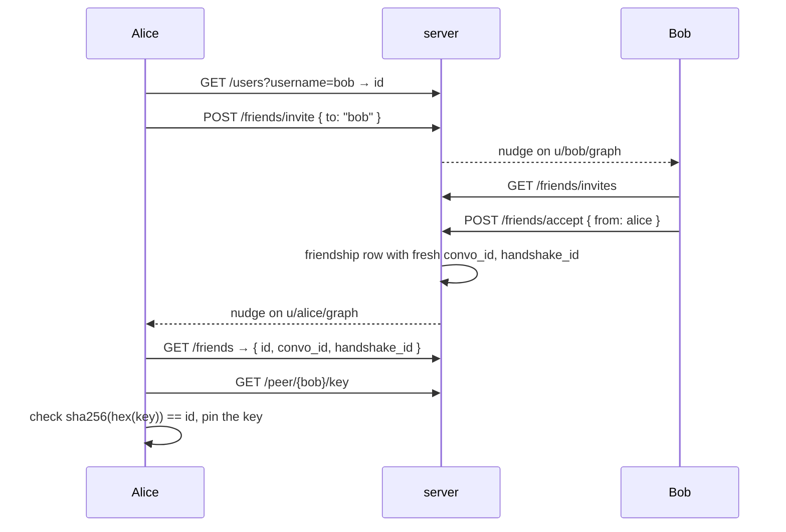

# Message flow

One message end to end: becoming friends, the first contact, ordinary
messages, presence and waking an offline phone. The cryptography is specified
in [e2ee-protocol.md](e2ee-protocol.md); topics and their permissions in
[emqx-acl.md](emqx-acl.md).

## Topics

| Topic | Who subscribes | Who publishes | Carries |
|---|---|---|---|
| `u/{id}/inbox` | its owner | any signed-in client | `init` frames (first contact) |
| `u/{id}/graph` | its owner | the server, through the admin API | a nudge: "your friend graph changed" |
| `u/{id}/presence` | anyone | its owner (retained, and as the Last-Will) | `{"s":"online"}` or `{"s":"offline"}` |
| `cv/{convo_id}` | the two members | the two members | conversation frames |
| `hs/{handshake_id}` | the two members | the two members | handshake challenges and proofs |

`convo_id` and `handshake_id` are random 256-bit ids minted with the
friendship and handed only to its members.

## 1. Becoming friends



Both clients re-read `/friends` on every nudge and every 60 seconds, subscribe
to each friendship's `cv/` and `hs/` topics and to each friend's presence, and
fetch any identity key they lack (once per contact, verified against its id).
Limits: 150 friends, 20 invites a day. Cancelling, declining, removing and
blocking all nudge both sides; removing or blocking also retires the topic ids
and drops both members' live subscriptions to them.

## 2. The first message

```mermaid
sequenceDiagram
    participant A as Alice
    participant S as server
    participant E as EMQX
    participant B as Bob
    A->>S: POST /prekeys/claim { peer: bob }
    S-->>A: identity, medium-term and one-time prekey
    A->>A: startAsInitiator, seal "hi"
    A->>E: publish init on u/bob/inbox
    E-->>B: init
    B->>E: challenge on hs/{handshake_id}
    E-->>A: challenge
    A->>E: proof on hs/{handshake_id}
    E-->>B: proof
    B->>B: startAsResponder, open "hi"
    B->>E: reply on cv/{convo_id} (steps the ratchet)
    E-->>A: reply; Alice stops attaching the init fields
```

Bob proves Alice once per app run: later `init`s from her are opened directly.
Until Alice hears back, every frame she sends is an `init` on Bob's inbox, so
any of them can open the session if earlier ones were lost.

## 3. Ordinary messages

The sender seals with the next message key (stepping first when the policy
says so) and publishes the frame at QoS 1 on `cv/{convo_id}`. A message shows
`sent` once published while the peer is online, `queued` when the peer was
offline (the broker holds it in their session), `delivered` when the peer's
receipt arrives, and `failed` if sealing or publishing threw; a failed message
can be retried under the same message id. States only move forward, so a
receipt that beats the publish callback is not overwritten. There are no read
receipts.

The receipt is a sealed `receipt` frame on the same topic whose `msgId` names
the message ([e2ee-protocol.md](e2ee-protocol.md#the-frame)): the server sees
one more small frame and learns nothing it could not already infer from timing.

The receiver checks the frame is addressed to it, from that friendship's
member, on the right topic, then opens it. The plaintext is shown and stored
sealed (see [e2ee-protocol.md](e2ee-protocol.md#at-rest-on-the-device)).

## 4. While a phone is offline

Clients connect with `cleanSession = false` and subscribe at QoS 1, so EMQX
keeps an offline client's session and queues its messages until it reconnects
(EMQX's default session expiry of two hours). Messages older than that are
lost to that client.

## 5. Presence and push

On connect a client publishes `{"s":"online"}`, retained, to its presence
topic; its Last-Will is `{"s":"offline"}`. Going to the background, iOS
publishes `offline` itself and holds a background task until the frame is
written, since a suspended socket would keep it "online" until the keepalive
(60 s) lapses.

The push bridge, inside `hqcat-server`, subscribes to every presence topic and
(through a shared subscription) to every `cv/` topic. For each conversation
frame it looks up the friendship's two members and sends an APNs alert to each
member it believes offline. The alert is content-free: title "New message",
body "You have a new message". A phone that receives it opens the app, which
reconnects and drains its queued session.

In the foreground the app raises its own local notifications for messages and
invites in other conversations, titled with the sender's name and never the
text.

## 6. Reports and blocking

From a message (or the conversation header), a user can report to the
operator, which uploads that message's text as they see it plus a category and
an optional note, and optionally block. The report is sent before the block,
because only conversation members may report. Operators work the queue with
`hqcat-ops reports` ([moderation runbook](../runbooks/moderation.md)); reports
are deleted after 90 days.
