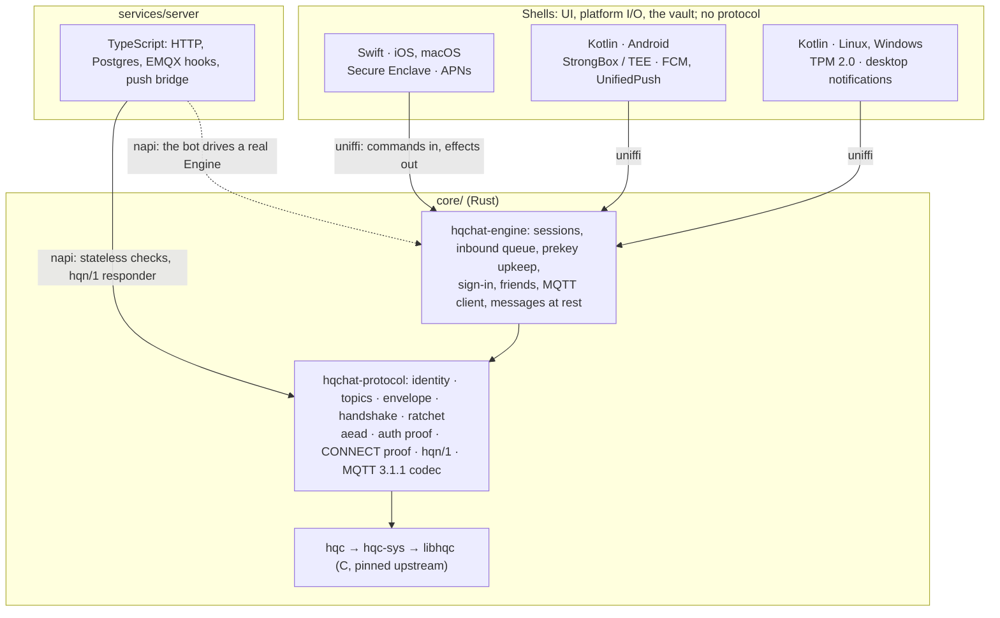

# Multiplatform: one core, four platforms

**Status: proposal, not built.** How HQChat goes from two Apple targets to
iOS, macOS, Android, Linux and Windows without a second or third copy of the
protocol. Moving an account between devices is a separate plan, built on top
of this one. The flow of one message through the core, function by function,
is in [core-wiring.md](core-wiring.md).

## Decisions

| Question | Decision |
|---|---|
| Where the protocol lives | One Rust workspace, `core/`, wrapping the pinned C `libhqc`. Every client and the server link it |
| Core shape | Sans-IO: commands in, effects out. MQTT and hqn/1 inside the core; shells are byte pipes. Messages at rest sealed by the core |
| Targets | arm64 everywhere, plus x86_64 for the Android emulator, Linux and Windows. No 32-bit; macOS arm64 only |
| Apple (iOS, macOS) | Swift (SwiftUI), as today, on top of the core. macOS does not move to the desktop shell |
| Android, Linux, Windows | Kotlin. Compose Multiplatform: one shell, an Android target and a desktop (JVM) target |
| Minimum versions | Android 12 (API 31: ECDH inside the Keystore); Windows 11 (TPM 2.0 guaranteed) |
| Hardware keys | Always used when the device has them. Without them the app still runs, on a weaker tier, with a warning; nothing else changes |
| Licence of the core | AGPL-3.0, like the server |
| Licence of every app | PolyForm Strict, like `apps/apple/` today (so no F-Droid) |
| Multi-device for one identity | Not provided, as today |
| Moving an account | Out of scope here: its own plan (identity only, old device required) |

## The shape



Clean architecture in one rule: **the core never touches the outside world.**
It decides what every byte is; the shell moves the bytes, draws the UI and owns
the hardware key.

## Core architecture

### Crates

| Crate | Holds | Rules |
|---|---|---|
| `hqc-sys` | FFI declarations for `libhqc`; `build.rs` compiles `native/hqc` with the `cc` crate for whatever target is being built | the only crate with `unsafe` |
| `hqc` | safe HQC-256: sized `PublicKey`, `SecretKey`, `Ciphertext`, `SharedSecret`; keygen, encaps, decaps | secrets `zeroize` on drop |
| `hqchat-protocol` | everything in `services/server/src/protocol/` today, plus the MQTT 3.1.1 codec | `forbid(unsafe_code)`; no I/O, no clock, no global RNG (passed in, so vectors replay exactly) |
| `hqchat-engine` | the client: identity, sign-in and refresh, prekey upkeep, friends, sessions, the inbound queue, the MQTT client over hqn/1 or WebSocket, messages sealed at rest | sans-IO: commands in, effects out |
| `hqchat-ffi` | uniffi exports for Swift and Kotlin | the only crate that knows about bindings; thin |
| `hqchat-node` | napi-rs exports for the server, gateway, bot and reference client | thin |
| `hqchat-vault-desktop` | the desktop `KeyVault`: TPM 2.0 (tpm2-tss), Windows CNG + Hello, the passphrase fallback | exported to Kotlin through `hqchat-ffi`, because the JVM has no API for either |

The reference C is portable (no AVX2 path), so one source tree compiles for
every target; `build-apple.sh` and the Nix package become thin callers of the
same build.

### The client surface: one `Engine`

Shells get one high-level object, never primitives. **No secret key, ratchet
state or root key ever crosses the boundary.**

```
Engine::new(config, vault: KeyVault, store: Store) -> Engine

commands (each returns Vec<Effect>)        effects (the shell carries them out)
  create_identity()                          Http { req_id, method, path, body }
  unlock()                                   Open { conn_id, endpoint }
  send_text(peer, text)                      Write { conn_id, bytes }
  add_friend / accept / block / report       Close { conn_id }
  history(peer, before, limit)               MessageAdded · MessageStatus
  on_http(req_id, status, body)              FriendsChanged · TierChanged
  on_opened / on_bytes / on_closed           Notify { peer }   (never content)
  tick(now)                                  Timer { at } · NeedUnlock
```

- **Commands in, effects out.** No async crosses the boundary: no Rust runtime
  in the app, no bridging of Swift concurrency or Kotlin coroutines into Rust.
  The shell decides when network work happens, which is what iOS background
  modes and Android Doze demand.
- **The shell is a byte pipe.** `Open` names an endpoint: raw TCP for hqn/1
  (the core runs Noise and MQTT inside it) or a WebSocket, which the shell
  opens with the platform TLS stack and its SPKI pinning. TLS stays native
  because that is what the stores review; Swift's `MQTTWireClient` and the
  TS mqtt.js dependency are replaced by one fuzzed Rust codec.
- **Two synchronous callbacks**, both local and fast:
  - `KeyVault`: create the device key, give its public key, one hardware
    ECDH, report the tier. The core does ECIES itself: sealing needs only the
    public key (works while locked), opening needs the hardware ECDH.
  - `Store`: get, put, delete, list opaque blobs by key.
  Biometric unlock is UI: the shell prompts, then calls `unlock()`, and the
  vault calls that follow run under the already-authenticated context.
- **Messages at rest belong to the core.** Each message is sealed through
  the vault's key in one format on every platform; the shell asks for history
  with `history` and never parses stored rows.
- **The clock** comes in with every command; the core applies the
  `serverTime` offset itself.

### The server surface

Stateless functions, plus two objects:

| Export | Used by |
|---|---|
| `hqcEncaps`, `hqcDecaps`, `hqcKeypairFromSeed` | `/auth/init`, the gateway's keys and decap worker |
| `authProof`, constant-time compare | `/auth/verify` |
| `parseConnectProof`, `verifyConnectProof` | `/mqtt/authn` |
| `peerId`, `isPeerId`, topic builders | routes, EMQX helpers |
| `HqnResponder` (stateful) | `hqcat-noise-gw` |
| `Engine` (same as the apps') | `hqcat-bot`, the reference client, scenario tests |

TypeScript keeps HTTP, Postgres, EMQX hooks and the push bridge. Because the
bot runs the apps' own `Engine`, every scenario test exercises real client
code.

### Crossing the boundary

| Concern | Rule |
|---|---|
| Data | uniffi records and enums; bytes as `Vec<u8>` (a 14 KB copy per handshake is noise) |
| Errors | one `CoreError` enum with stable codes, never a string the UI parses |
| Panics | `panic = "unwind"` for the FFI crates so uniffi and napi turn a panic into an error; an abort would kill the app with no report |
| Secrets | `zeroize`d; never uniffi records, only fields of opaque objects |
| Threads | `Engine` is `Send + Sync` with internal locking; no call blocks on I/O. Swift wraps it in an actor, Kotlin in a single-thread dispatcher |
| Persisted state | the core serializes its own state (versioned postcard), seals it through the vault, stores it through `Store` |
| Existing installs | a one-time importer reads today's Swift-encoded identity, sessions and message rows and rewrites them in the core format |
| Drift | bindings generated at build time, never edited; `core_api_version()` checked at startup |

### Targets

| Consumer | Rust targets | Artifact |
|---|---|---|
| iOS | `aarch64-apple-ios`, `aarch64-apple-ios-sim` | static lib in `HQChatCore.xcframework` + generated Swift |
| macOS | `aarch64-apple-darwin` (arm64 only, as today) | same xcframework |
| Android | `aarch64-linux-android`, `x86_64-linux-android` (emulator); no 32-bit | AAR, `.so` linked for 16 KB pages, built with cargo-ndk |
| Linux | `x86_64-unknown-linux-gnu`, `aarch64-unknown-linux-gnu` | `.so` in the desktop jar (`linux-x86-64/`, `linux-aarch64/`), built with `cargo zigbuild` against the chosen glibc |
| Windows | `x86_64-pc-windows-msvc`, `aarch64-pc-windows-msvc` | `.dll` in the jar (`win32-x86-64/`, `win32-aarch64/`), static CRT |
| Server | `x86_64-unknown-linux-gnu` (droplets), `aarch64-apple-darwin` (dev) | `.node` addon from Nix; no npm prebuild |

Kotlin loads the native library through JNA, as uniffi does, on Android and on
desktop. Each artifact has one entry point (`nix build .#core-aar`,
`.#core-jar`, `.#core-node`); the xcframework builds on a Mac from `verify.sh`.

### Proving it on every architecture

1. The vector files in `services/server/test/helpers/` (`identity`,
   `envelope-v3`, `handshake`, `double-ratchet`, `mqtt-proof`, `noise-hqn`,
   `noise-nk-cacophony`) move to `core/vectors/` and become Rust tests.
2. Those tests and the HQC known-answer digests run on every target: natively,
   under qemu (Linux arm64), in the Android emulator, in the iOS simulator and
   on GitHub's Windows ARM runner.
3. A binding conformance suite replays the same JSON through Swift, Kotlin and
   Node, which catches marshalling bugs the Rust tests cannot see.
4. The existing differential fuzzers (`services/server/test/fuzz/`,
   `apps/apple/fuzz/`) run Rust against TS and Swift until those copies are
   deleted; then cargo-fuzz keeps the targets.

## Hardware keys on every platform

The hardware key is a **P-256 key that never leaves the chip**. It does not
hold the HQC key (no enclave speaks HQC). It seals everything secret: the HQC
identity secret key, ratchet sessions, prekey secrets, stored messages. Today
the identity key sits in the Keychain behind the tier; under this design the
enclave seals it on Apple too.

| Platform | Strong tier | Fallback tier (warned, not penalised) |
|---|---|---|
| iOS, macOS | Secure Enclave + Face ID / Touch ID | passcode (the existing reduced tier) |
| Android | StrongBox, else TEE (`KeyInfo.securityLevel`), + BiometricPrompt | software Keystore, device credential |
| Windows | TPM 2.0 via the Platform Crypto Provider + Windows Hello | no TPM: key in DPAPI, sealed under a passphrase (Argon2id) |
| Linux | TPM 2.0 / fTPM via tpm2-tss (`/dev/tpmrm0`) | no TPM or no access: Secret Service if present, sealed under a passphrase (Argon2id) |

The fallback tier:

- is shown once at setup and permanently in settings ("keys are protected by
  your passphrase, not by hardware"), like the reduced tier today;
- changes nothing else: no feature is withheld and peers are never told, so
  nobody is pushed off the app for running Linux in a VM;
- is a property of the device, stored next to the key, and re-checked at each
  launch (a TPM that appears later offers an upgrade; one that disappears is an
  error, never a silent downgrade).

## Repository after the change

| Path | Contents | Licence |
|---|---|---|
| `core/` | Rust workspace: `hqc-sys`, `hqc`, `hqchat-protocol`, `hqchat-engine`, `hqchat-ffi` (uniffi), `hqchat-node` (napi), `hqchat-vault-desktop`; `vectors/`, fuzz targets | AGPL-3.0 |
| `native/hqc/` | the C wrapper, unchanged, consumed by `hqc-sys` | AGPL-3.0 |
| `apps/apple/` | Swift shell; `Services/` keeps the vault, byte pipes, push and UI glue, loses the protocol, MQTT and session code | PolyForm Strict |
| `apps/kotlin/` | `shared/` (Compose UI, view models, the effect loop), `android/`, `desktop/` | PolyForm Strict |
| `services/server/` | `src/protocol/` and most of `src/client/` replaced by the napi binding; koffi and mqtt.js dropped | AGPL-3.0 |

The core is AGPL for everyone else; the official apps link it because the
maintainer holds the copyright. That only stays true if every contribution to
`core/` carries the same grant `apps/apple/` contributions do today
(CONTRIBUTING.md and LICENSING.md need the clause).

## Branches

One integration branch per area, one branch per feature, one pull request per
feature. Git cannot hold a branch `lib` next to `lib/…`, so each area's
integration branch is `<area>/main`.

```
main                       releases only
└─ dev                     everything that is ready together
   ├─ docs/multiplatform   this document and core-wiring.md
   ├─ lib/main             the Rust core            ← lib/<feature>
   ├─ server/main          the server on the core   ← server/<feature>
   ├─ apple/main           the iOS and macOS shell  ← apple/<feature>
   ├─ android/main         the Android shell        ← android/<feature>
   └─ desktop/main         the Linux and Windows shell ← desktop/<feature>
```

- A feature branch starts from its area's `main`, does one thing, and merges
  back by pull request with CI green. Commits inside it are small and each one
  builds.
- An area merges into `dev` when a phase below is done; `dev` merges into
  `main` for a release.
- A consumer area takes the core by merging `lib/main` into its own `main`,
  never by cherry-picking.
- Feature branches are created when their work starts, not ahead of time, so
  none goes stale. The first ones:

| Area | Feature branches, in order |
|---|---|
| `lib` | `lib/hqc-sys` (workspace, `hqc-sys`, `hqc`, KATs) → `lib/protocol-identity-topics` → `lib/protocol-aead-envelope` → `lib/protocol-handshake` → `lib/protocol-ratchet` → `lib/protocol-mqtt-proof` → `lib/protocol-noise` → `lib/protocol-mqtt-codec` → `lib/fuzz-differential` → `lib/engine-conversations` → `lib/engine-auth` → `lib/engine-prekeys-friends` → `lib/engine-mqtt-session` → `lib/engine-at-rest` → `lib/node-binding` → `lib/ffi-binding` → `lib/conformance` → `lib/vault-desktop` |
| `server` | `server/napi-protocol` → `server/napi-gateway` → `server/engine-client` (bot, scenarios) → `server/push-fcm-unifiedpush` |
| `apple` | `apple/core-xcframework` → `apple/effect-loop` → `apple/enclave-vault` → `apple/importer` → `apple/views-on-engine` → `apple/remove-swift-protocol` |
| `android` | `android/scaffold` → `android/effect-loop` → `android/keystore-vault` → `android/push` → `android/ui` → `android/release` |
| `desktop` | `desktop/scaffold` → `desktop/effect-loop` → `desktop/linux-packaging` → `desktop/windows-msix` |

## Phases

Each phase ships on its own and leaves every existing client working.

| # | Phase | Branches | Done when |
|---|---|---|---|
| 1 | **Protocol.** `hqc-sys`, `hqc`, `hqchat-protocol` with the MQTT codec; vectors moved to `core/vectors/`; differential fuzzing against TS and Swift | `lib/hqc-sys` … `lib/fuzz-differential` | every vector passes on every target; differential fuzz clean |
| 1b | **Engine.** `hqchat-engine`, `hqchat-ffi`, `hqchat-node`; the binding conformance suite | `lib/engine-*`, `lib/*-binding`, `lib/conformance` | the bot runs on the `Engine` against staging |
| 2 | **Server on the core.** napi binding replaces `src/protocol` and koffi in the server, gateway, bot and reference client | `server/napi-*`, `server/engine-client` | unit, integration and scenario layers green; deployed to staging, then production |
| 3 | **Apple on the core.** xcframework behind a flag; the importer rewrites existing identity, sessions and messages on first launch; the identity key moves under the enclave seal; Swift protocol, MQTT and session files deleted once `verify.sh` passes both ways | `apple/*` | an App Store update with no visible change |
| 4 | **Server for new platforms.** Push bridge gains FCM and UnifiedPush; push tokens carry a platform | `server/push-fcm-unifiedpush` | scenarios cover each provider with a fake |
| 5 | **Android.** Kotlin shell, Android target; Keystore vault; FCM + UnifiedPush + foreground-service fallback; `allowBackup=false`, `FLAG_SECURE` | `android/*` | Play internal testing; interop with iOS and the bot |
| 6 | **Linux and Windows.** Desktop target of the same shell; `hqchat-vault-desktop` with TPM and fallback tiers | `lib/vault-desktop`, `desktop/*` | Flathub + Nix + AppImage; signed MSIX + winget |
| 7 | **Release.** Export-compliance and ANSSI / BIS filings updated for the new platforms; Play listing, Data safety form; site download page | `dev` → `main` | stores approved |

CI: phases 1, 2, 4 to 6 run on Linux runners (Android emulator included);
Windows gets runner jobs for the vault and the MSIX; Apple stays on
`verify.sh`.

## Risks

| Risk | Where | Mitigation |
|---|---|---|
| The Rust port behaves differently from the shipped Swift and TS | 1, 3 | the vectors are the contract; differential fuzzing against both before either is deleted |
| Late messages on Android (Doze, OEM battery killers, FCM deprioritising silent pushes) | 5 | content-free visible notification on every push; UnifiedPush; foreground-service option; dontkillmyapp guidance in-app |
| Ratchet state copied off the device by backup | 5, 6 | `allowBackup=false`; Store excluded from OneDrive / Windows backup paths; everything sealed regardless |
| HQC on arm64 Android: build flags, 16 KB pages, constant time | 1, 5 | known-answer digests on device in CI; timing test on a real arm64 device |
| HQC's large stack buffers on small thread stacks (512 KB on iOS secondary threads) | 1, 3, 5 | measure peak stack; run HQC on a core-owned thread with an explicit stack size if needed |
| The importer loses or corrupts an existing Apple install | 3 | importer keeps the old items until the new ones open; tested against stores captured from every shipped version; staged rollout |
| A marshalling bug the Rust tests cannot see | 1b, 3, 5 | the binding conformance suite runs the vectors through Swift, Kotlin and Node |
| TPM access denied on Linux (`tss` group, Flatpak sandbox) | 6 | detect and say so; fallback tier; document the one command that fixes it |
| Windows signing: unsigned MSIX is blocked by SmartScreen | 6 | code-signing certificate (Azure Trusted Signing) budgeted before phase 6 |
| Clock skew beyond ±60 s on desktops | 6 | already absorbed by the `serverTime` offset; scenario test with a skewed clock |
| Separate identities per device confuse people with phone + laptop | all | the account-transfer plan covers "new phone"; multi-device stays a later, separate design |

## Open

- The Linux baseline the desktop build targets (oldest glibc; which
  distributions are tested).
- The account-transfer plan, written separately.
- The push bridge (`src/server/push.ts`) wakes on `cv/+` only, so an `init`
  sent to an offline peer's inbox wakes nobody. Intentional or not, it
  matters before Android.
