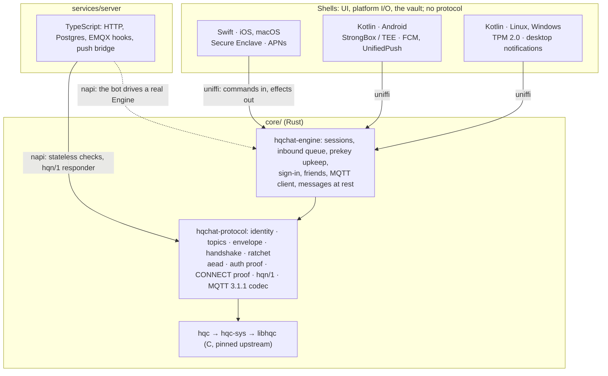

# Multiplatform: one core, four platforms

**Status: the core (phases 1 and 1b) is built in `core/`; the server, the
hqn/1 gateway and the helper bot run on it (phase 2, built and merged to
`main`), and so do the Apple apps (phase 3, built and merged to `main`; iOS
3.1.1, the first release on the core, built from source at 7788ea2 by the
Apple release workflow, was approved on 2026-10-24). Phases 4 to 7 (Android, Linux, Windows) have not started.** How HQChat goes from two Apple targets to
iOS, macOS, Android, Linux and Windows without a second or third copy of the
protocol. Moving an account between devices is a separate plan, built on top
of this one. The flow of one message through the core, function by function,
is in [core-wiring.md](core-wiring.md).

## Decisions

| Question | Decision |
|---|---|
| Where the protocol lives | One Rust workspace, `core/`, wrapping the pinned C `libhqc`. Every client and the server link it |
| Core shape | Sans-IO: commands in, effects out. MQTT 3.1.1 (persistent session, as the Apple app) and hqn/1 inside the core; shells are byte pipes. Messages at rest sealed by the core |
| Targets | arm64 everywhere, plus x86_64 for the Android emulator, Linux and Windows. No 32-bit; macOS arm64 only |
| Apple (iOS, macOS) | Swift (SwiftUI), as today, on top of the core. macOS does not move to the desktop shell |
| Android, Linux, Windows | Kotlin. Compose Multiplatform: one shell, an Android target and a desktop (JVM) target |
| Minimum versions | Android 12 (API 31: ECDH inside the Keystore); Windows 11 (TPM 2.0 guaranteed) |
| Hardware keys | Always used when the device has them. Without them the app still runs, on a weaker tier, with a warning; nothing else changes |
| Licence of the core | AGPL-3.0, like the server |
| Licence of every app | PolyForm Strict, like `apps/apple/` today (so no F-Droid) |
| Multi-device for one identity | Not provided, as today |
| Moving an account | Out of scope here: its own plan (identity only, old device required) |

## The shape



Clean architecture in one rule: **the core never touches the outside world.**
It decides what every byte is; the shell moves the bytes, draws the UI and owns
the hardware key.

## Core architecture

### Crates

| Crate | Holds | Rules |
|---|---|---|
| `hqc-sys` | FFI declarations for `libhqc`; `build.rs` compiles `native/hqc` with the `cc` crate for whatever target is being built | the only crate with `unsafe` |
| `hqc` | safe HQC-256: sized `PublicKey`, `SecretKey`, `Ciphertext`, `SharedSecret`; keygen, encaps, decaps | secrets `zeroize` on drop |
| `hqchat-protocol` | everything in `services/server/test/reference/protocol/` today, plus the MQTT 3.1.1 codec | `forbid(unsafe_code)`; no I/O, no clock, no global RNG (passed in, so vectors replay exactly) |
| `hqchat-engine` | the client: identity, sign-in and refresh, prekey upkeep, friends, sessions, the inbound queue, the MQTT client over hqn/1 or WebSocket, messages sealed at rest | sans-IO: commands in, effects out |
| `hqchat-ffi` | uniffi exports for Swift and Kotlin | the only crate that knows about bindings; thin |
| `hqchat-node` | napi-rs exports for the server, gateway, bot and reference client | thin |
| `hqchat-vault-desktop` | the desktop `KeyVault`: TPM 2.0 (tpm2-tss), Windows CNG + Hello, the passphrase fallback | exported to Kotlin through `hqchat-ffi`, because the JVM has no API for either |

The reference C is portable (no AVX2 path), so one source tree compiles for
every target; `build-apple.sh` and the Nix package become thin callers of the
same build.

### The client surface: one `Engine`

Shells get one high-level object, never primitives. **No secret key, ratchet
state or root key ever crosses the boundary.**

```
Engine::new(config, vault: KeyVault, store: Store) -> Engine

commands (each returns Vec<Effect>)          effects (the shell carries them out)
  create_identity · import · start             Http { req, method, path, authorization, body }
  unlock · lock · tick(now) · set_presence     Open { conn, endpoint } · Write · Close
  send_text · retry · mark_read                Timer { at } · NeedUnlock { reason }
  invite · cancel · accept · remove            MessageAdded · MessageStatus
  block · unblock · forget · report            FriendsChanged · InvitesChanged · ActionDone
  set_verified · rotate_keys                   PresenceChanged · Connection · TierChanged
  set_username · delete_account                Notify { peer? }   (never content)
  register_push                                ActionFailed · AccountDeleted · Dropped
  on_http · on_opened · on_bytes · on_closed   StorageFailed
  on_network_changed

reads: history(peer, before, limit) · friends() · invites() · sent_invites()
       fingerprint(peer) · my_id()
```

Every function, and what it replaces in the Apple app and the server, is in
[core-wiring.md](core-wiring.md).

- **Commands in, effects out.** No async crosses the boundary: no Rust runtime
  in the app, no bridging of Swift concurrency or Kotlin coroutines into Rust.
  The shell decides when network work happens, which is what iOS background
  modes and Android Doze demand.
- **The shell is a byte pipe.** `Open` names an endpoint: raw TCP for hqn/1
  (the core runs Noise and MQTT inside it) or a WebSocket, which the shell
  opens with the platform TLS stack and its SPKI pinning. TLS stays native
  because that is what the stores review; Swift's `MQTTWireClient` and the
  TS mqtt.js dependency are replaced by one fuzzed Rust codec.
- **Two synchronous callbacks**, both local and fast:
  - `KeyVault`: create the device key, give its public key, one hardware
    ECDH, give the 256-bit state secret, report the tier. The core does ECIES
    itself: sealing needs only the public key (works while locked), opening
    needs the hardware ECDH; `state` also needs the state secret, so it does
    not rest on P-256 alone.
  - `Store`: get, put, delete, list opaque blobs by key.
  Biometric unlock is UI: the shell prompts, then calls `unlock()`, and the
  vault calls that follow run under the already-authenticated context.
- **Messages at rest belong to the core.** Each message is sealed through
  the vault's key in one format on every platform; the shell asks for history
  with `history` and never parses stored rows.
- **The clock** comes in with every command; the core applies the
  `serverTime` offset itself.

### The server surface

The Node addon (`core/hqchat-node`, packaged by `core/hqchat-node/package.nix`
and loaded through `services/common/src/core.ts`, whose types a unit test keeps equal to
the exports):

| Export | Used by |
|---|---|
| `authChallenge`, `originOf`, `authProofMatches`, `HQC_PUBLIC_KEY_BYTES` | `/auth/init` and `/auth/verify`: the challenge and its expected proof come back together, and the shared secret never reaches JavaScript |
| `parseConnectProof`, `isFreshTimestamp`, `verifyConnectProof`, `isSigningKey`, `MQTT_PROOF_NONCE_TTL_SECONDS` | `/mqtt/authn`, `/auth/verify` and `/auth/refresh` (a registered key must be a canonical, non-small-order Ed25519 point) |
| `peerId`, `isPeerId`, `keyMatchesId`, `conversationTopic`, `handshakeTopic`, `PEER_ID_LENGTH` | routes, the users table, EMQX revocation |
| `GatewayKeyPair` (built once at startup from the key seeds; its `decapsulate` runs on the libuv pool and returns an opaque `HqnSecret`), `HqnGatewayHandshake`, `HqnTransport`, `hqnMsg1Length`, `hqnFrame`, `HQN_VERSION` | `hqcat-noise-gw`: the HQC secret key and the shared secrets stay in the core |
| `hqcKeypairFromSeed`, `deviceKeyFromSeed`, `Engine` with `importLegacy` | `hqcat-bot` (through `services/common/src/core-client.ts`): its identity and device key derive from its seed, and nothing secret is stored; the core scenario |
| `hqcEncapsulate`, `hqcDecapsulate` | tests only |

TypeScript keeps HTTP, Postgres, EMQX hooks and the push bridge. The bot runs
the apps' own `Engine`, so every scenario that talks to it exercises real
client code; `test/scenarios/core.test.ts` also puts an engine user and a
user on the TS reference client in one conversation. The TS protocol and
client the server used to run on live on in `services/server/test/reference/`
as an independent implementation: the differential fuzzers compare it with
the core (`hqchat-verdict`), as they compare it with the Swift app.

### Crossing the boundary

| Concern | Rule |
|---|---|
| Data | uniffi records and enums; bytes as `Vec<u8>` (a 14 KB copy per handshake is noise) |
| Errors | one `CoreError` enum with stable codes, never a string the UI parses |
| Panics | `panic = "unwind"`, and every `Engine` call under `catch_unwind`, so uniffi and napi turn a panic into an error; an abort would kill the app with no report |
| Secrets | `zeroize`d; never uniffi records, only fields of opaque objects |
| Threads | `Engine` is `Send + Sync` with internal locking; no call blocks on I/O. Swift wraps it in an actor, Kotlin in a single-thread dispatcher |
| Persisted state | `state` (identity, prekeys, directory, outbox, a data key) sealed under P-256 ECDH with the device key joined with the vault's state secret, written only while unlocked. Sessions (`session/{peer tag}`) and messages (`msg/{peer tag}/{time}/{id tag}`) under the data key, where a tag is an HMAC under a key derived from the data key, so slot names list no friend and no message id; frames that arrive locked (`pending/…`) sealed to the device key alone (they are ratchet ciphertext already). Versioned postcard; every blob bound to its key as AAD |
| Existing installs | a one-time importer reads today's Swift-encoded identity, sessions and message rows and rewrites them in the core format |
| Drift | bindings generated at build time, never edited; `core_api_version()` checked at startup |

### Targets

| Consumer | Rust targets | Artifact |
|---|---|---|
| iOS | `aarch64-apple-ios`, `aarch64-apple-ios-sim` | static lib in `HQChatCore.xcframework` + generated Swift |
| macOS | `aarch64-apple-darwin` (arm64 only, as today) | same xcframework |
| Android | `aarch64-linux-android`, `x86_64-linux-android` (emulator); no 32-bit | AAR, `.so` linked for 16 KB pages, built with cargo-ndk |
| Linux | `x86_64-unknown-linux-gnu`, `aarch64-unknown-linux-gnu` | `.so` in the desktop jar (`linux-x86-64/`, `linux-aarch64/`), built with `cargo zigbuild` against the chosen glibc |
| Windows | `x86_64-pc-windows-msvc`, `aarch64-pc-windows-msvc` | `.dll` in the jar (`win32-x86-64/`, `win32-aarch64/`), static CRT |
| Server | `x86_64-unknown-linux-gnu` (droplets), `aarch64-apple-darwin` (dev) | `.node` addon from Nix; no npm prebuild |

Kotlin loads the native library through JNA, as uniffi does, on Android and on
desktop. Each artifact has one entry point (`.#hqchat-node` today; `.#core-aar`
and `.#core-jar` with their phases); the xcframework builds on a Mac
(`core/hqchat-ffi/build-apple.sh`, from `verify.sh` and from the Apple release
workflow) and is never committed.

### Proving it on every architecture

1. The vector files in `services/server/test/helpers/` (`identity`,
   `envelope-v3`, `handshake`, `double-ratchet`, `mqtt-proof`, `noise-hqn`,
   `noise-nk-cacophony`) are read in place by the Rust tests, so TS, Swift
   and Rust share one copy of each.
2. Those tests and the HQC known-answer digests run on every target: natively,
   under qemu (Linux arm64), in the Android emulator, in the iOS simulator and
   on GitHub's Windows ARM runner.
3. A binding conformance suite replays the same JSON through Swift, Kotlin and
   Node, which catches marshalling bugs the Rust tests cannot see.
4. The differential fuzzers (`services/server/test/fuzz/`) run Rust against
   the TS reference; Swift's copy is deleted. cargo-fuzz targets for the
   decoders the Swift fuzzers covered alone (MQTT, topic routing, ratchet
   state) are still to write.

## Hardware keys on every platform

The hardware key is a **P-256 key that never leaves the chip**. It does not
hold the HQC key (no enclave speaks HQC). It seals everything secret: the HQC
identity secret key, ratchet sessions, prekey secrets, stored messages. Today
the identity key sits in the Keychain behind the tier; under this design the
enclave seals it on Apple too.

| Platform | Strong tier | Fallback tier (warned, not penalised) |
|---|---|---|
| iOS, macOS | Secure Enclave + Face ID / Touch ID | passcode (the existing reduced tier) |
| Android | StrongBox, else TEE (`KeyInfo.securityLevel`), + BiometricPrompt | software Keystore, device credential |
| Windows | TPM 2.0 via the Platform Crypto Provider + Windows Hello | no TPM: key in DPAPI, sealed under a passphrase (Argon2id) |
| Linux | TPM 2.0 / fTPM via tpm2-tss (`/dev/tpmrm0`) | no TPM or no access: Secret Service if present, sealed under a passphrase (Argon2id) |

The fallback tier:

- is shown once at setup and permanently in settings ("keys are protected by
  your passphrase, not by hardware"), like the reduced tier today;
- changes nothing else: no feature is withheld and peers are never told, so
  nobody is pushed off the app for running Linux in a VM;
- is a property of the device, stored next to the key, and re-checked at each
  launch (a TPM that appears later offers an upgrade; one that disappears is an
  error, never a silent downgrade).

## Repository after the change

| Path | Contents | Licence |
|---|---|---|
| `core/` | Rust workspace: `hqc-sys`, `hqc`, `hqchat-protocol`, `hqchat-engine`, `hqchat-ffi` (uniffi), `hqchat-node` (napi); `hqchat-vault-desktop` in phase 6 | AGPL-3.0 |
| `native/hqc/` | the C wrapper, unchanged, consumed by `hqc-sys` | AGPL-3.0 |
| `apps/apple/` | Swift shell; `Services/` keeps the vault, byte pipes, push and UI glue, loses the protocol, MQTT and session code | PolyForm Strict |
| `apps/kotlin/` | `shared/` (Compose UI, view models, the effect loop), `android/`, `desktop/` | PolyForm Strict |
| `services/server/` | the server on the napi binding; `src/protocol` and `src/client` moved to `test/reference/` (test-only); koffi and `HQC_LIB` dropped; mqtt.js kept for the push bridge and the reference client | AGPL-3.0 |

The core is AGPL for everyone else; the official apps link it because the
maintainer holds the copyright. That only stays true if every contribution to
`core/` carries the same grant `apps/apple/` contributions do today
(CONTRIBUTING.md and LICENSING.md need the clause).

## Branches

One integration branch per area, one branch per feature, one pull request per
feature. Git cannot hold a branch `lib` next to `lib/…`, so each area's
integration branch is `<area>/main`.

```
main                       releases only
└─ dev                     everything that is ready together
   ├─ lib/main             the Rust core and these documents ← lib/<feature>
   ├─ server/main          the server on the core   ← server/<feature>
   ├─ bot/main             the helper bot, a client of the server ← bot/<feature>
   ├─ apple/main           the iOS and macOS shell  ← apple/<feature>
   ├─ android/main         the Android shell        ← android/<feature>
   └─ desktop/main         the Linux and Windows shell ← desktop/<feature>
```

- A feature branch starts from its area's `main`, does one thing, and merges
  back by pull request with CI green. Commits inside it are small and each one
  builds.
- An area merges into `dev` when a phase below is done; `dev` merges into
  `main` for a release.
- A consumer area takes the core by merging `lib/main` into its own `main`,
  never by cherry-picking.
- Feature branches are created when their work starts, not ahead of time, so
  none goes stale. Once an area's run of features is done, its branches are
  fast-forwarded into its `main` and deleted.

| Area | Feature branches, in order |
|---|---|
| `lib` | **Done, in `lib/main`:** `lib/hqc-sys` → `lib/api-surface` → `lib/protocol-identity-topics` → `lib/protocol-aead-envelope` → `lib/protocol-handshake` → `lib/protocol-ratchet` → `lib/protocol-mqtt-proof` → `lib/protocol-noise` → `lib/protocol-mqtt-codec` → `lib/engine-at-rest` → `lib/engine-auth` → `lib/engine-prekeys-friends` → `lib/engine-mqtt-session` → `lib/engine-conversations` → `lib/node-binding` → `lib/ffi-binding` → `lib/hostile-input` → `lib/ci-core`. **Later:** `lib/vault-desktop` (phase 6), `lib/fuzz-differential` (cargo-fuzz needs a nightly toolchain the dev shell does not pin) |
| `server` | **Done, in `server/main`:** `server/core-node-package` → `server/differential-rust-ts` → `server/napi-protocol` → `server/napi-gateway` → `server/engine-client` (bot, scenarios) → `server/remove-ts-protocol` → `server/push-inbox-wake` → `server/docs-phase2`. **Later:** `server/push-fcm-unifiedpush` (phase 4) |
| `bot` | **In `bot/main`:** `bot/secret-hygiene` → `bot/package` (`services/bot` and `services/common`, out of the server) → `bot/haiku` (opt-in AI replies) |
| `apple` | **Done, merged:** `apple/core-xcframework` → `apple/effect-loop` → `apple/enclave-vault` → `apple/importer` → `apple/views-on-engine` → `apple/remove-swift-protocol` |
| `android` | `android/scaffold` → `android/effect-loop` → `android/keystore-vault` → `android/push` → `android/ui` → `android/release` |
| `desktop` | `desktop/scaffold` → `desktop/effect-loop` → `desktop/linux-packaging` → `desktop/windows-msix` |

## Phases

Each phase ships on its own and leaves every existing client working.

| # | Phase | Branches | Done when |
|---|---|---|---|
| 1 | **Protocol (built).** `hqc-sys`, `hqc`, the API surface, `hqchat-protocol` with the MQTT codec; the shared vectors read in place; hostile input to every decoder | `lib/hqc-sys` … `lib/protocol-mqtt-codec`, `lib/hostile-input` | every vector passes: on macOS arm64 and in CI (Linux x86_64); the other targets with their phases |
| 1b | **Engine and bindings (built).** `hqchat-engine`, `hqchat-node`, `hqchat-ffi`; `scripts/check.sh core` in CI | `lib/engine-*`, `lib/*-binding`, `lib/ci-core` | two engines converse through a fake server and broker; Node and Swift run the bindings; the bot on staging comes with phase 2 |
| 2 | **Server on the core (built, on `main`).** The napi binding replaces `src/protocol` and koffi in the server, gateway and bot; the bot imports its TS state into the core on its first start, keeping its seed-derived id and its sessions | `server/*` (done list above) | unit, integration and scenario layers green (done, locally and with the Swift live check); deployed to staging, then production |
| 3 | **Apple on the core (built, on `main`; iOS 3.1.1 approved, release pending).** No flag: every earlier version is a Swift build and 3.1.1 runs on the core, with the Swift protocol, MQTT and session files deleted. On first launch the importer moves identity, prekeys, sessions, history (with read state) and blocked or vanished friends; it lives in `Migration/` and goes a few weeks later ([core-wiring.md](core-wiring.md#the-switch-phase-3)) | `apple/*` | an App Store update with no visible change |
| 4 | **Server for new platforms.** Push bridge gains FCM and UnifiedPush; push tokens carry a platform | `server/push-fcm-unifiedpush` | scenarios cover each provider with a fake |
| 5 | **Android.** Kotlin shell, Android target; Keystore vault; FCM + UnifiedPush + foreground-service fallback; `allowBackup=false`, `FLAG_SECURE` | `android/*` | Play internal testing; interop with iOS and the bot |
| 6 | **Linux and Windows.** Desktop target of the same shell; `hqchat-vault-desktop` with TPM and fallback tiers | `lib/vault-desktop`, `desktop/*` | Flathub + Nix + AppImage; signed MSIX + winget |
| 7 | **Release.** Export-compliance and ANSSI / BIS filings updated for the new platforms; Play listing, Data safety form; site download page | `dev` → `main` | stores approved |

CI: phases 1, 2, 4 to 6 run on Linux runners (Android emulator included);
Windows gets runner jobs for the vault and the MSIX; Apple stays on
`verify.sh`.

## Risks

| Risk | Where | Mitigation |
|---|---|---|
| The Rust port behaves differently from the shipped Swift and TS | 1, 3 | the vectors are the contract; differential fuzzing against both before either is deleted |
| Late messages on Android (Doze, OEM battery killers, FCM deprioritising silent pushes) | 5 | content-free visible notification on every push; UnifiedPush; foreground-service option; dontkillmyapp guidance in-app |
| Ratchet state copied off the device by backup | 5, 6 | `allowBackup=false`; Store excluded from OneDrive / Windows backup paths; everything sealed regardless |
| HQC on arm64 Android: build flags, 16 KB pages, constant time | 1, 5 | known-answer digests on device in CI; timing test on a real arm64 device |
| HQC's large stack buffers on small thread stacks (512 KB on iOS secondary threads) | 1, 3, 5 | measured: about 210 KiB at peak (`crypto_kem_dec` → `hqc_pke_encrypt` → `vect_mul`), then the 256 KiB stack scrub after each call; under 512 KB, to confirm on device in phases 3 and 5 |
| The Swift builds and 3.1.1 need different servers: the Swift builds send `/auth/init { pk }` and the v1 proof, which a server built from `main` refuses; 3.1.1 sends the origin and the v2 proof, which an older server refuses | 2, 3 | 3.1.1 and the server from the same commit go live together through the App Store workflow: Deploy on the `app-store/3.1.1` tag with `app_store_version` set, the app released only after verify. Installs still on a Swift build cannot sign in until they update |
| The importer loses or corrupts an existing Apple install | 3 | importer keeps the old items until the new ones open, and retries at each launch; tested against a store captured from a Swift build; App Store phased release |
| A user who skips the transition window loses their identity and history | 3 | the window is weeks, not days; the app then sets the profile up as new, and friends see the old identity as vanished |
| A marshalling bug the Rust tests cannot see | 1b, 3, 5 | the binding conformance suite runs the vectors through Swift, Kotlin and Node |
| TPM access denied on Linux (`tss` group, Flatpak sandbox) | 6 | detect and say so; fallback tier; document the one command that fixes it |
| Windows signing: unsigned MSIX is blocked by SmartScreen | 6 | code-signing certificate (Azure Trusted Signing) budgeted before phase 6 |
| Clock skew beyond ±60 s on desktops | 6 | already absorbed by the `serverTime` offset; scenario test with a skewed clock |
| Separate identities per device confuse people with phone + laptop | all | the account-transfer plan covers "new phone"; multi-device stays a later, separate design |

## Open

- The Linux baseline the desktop build targets (oldest glibc; which
  distributions are tested).
- The account-transfer plan, written separately.
- Settled: an offline user gets a content-free wake for any message,
  including a first one on their inbox (`src/server/push.ts`); reading it
  still needs the unlock. Handshake traffic wakes nobody.
- Settled: HQC's PRNG is one global SHAKE-256 state (`symmetric.c`), and
  after an encapsulation it still holds the sponge that produced the message
  and the salt; Keccak is invertible, so that memory gives the shared secret
  away. `core/hqc-sys` wipes it after each encapsulation, and zeroes the stack
  HQC used after every call. Nothing calls the old `hqc_kem_enc_wrap` any
  more: the server and the apps reach HQC only through the core, and the
  standalone Apple HQC build is deleted. The C reference itself stays
  untouched: it is the standard.
- The Kotlin bindings generate but are first compiled in phase 5; the Swift
  ones are compiled and run by `core/hqchat-ffi/swift/run.sh`.
- The at-rest format is the core's own: opening what the Apple app sealed
  (its Secure Enclave ECIES rows) is the importer's job
  (`apps/apple/HQChat/Migration/`), run once per profile on the first unlock
  after the update, then deleted a few weeks after that release.
- The server accepts APNs tokens only; FCM and UnifiedPush registrations fail
  until phase 4.
