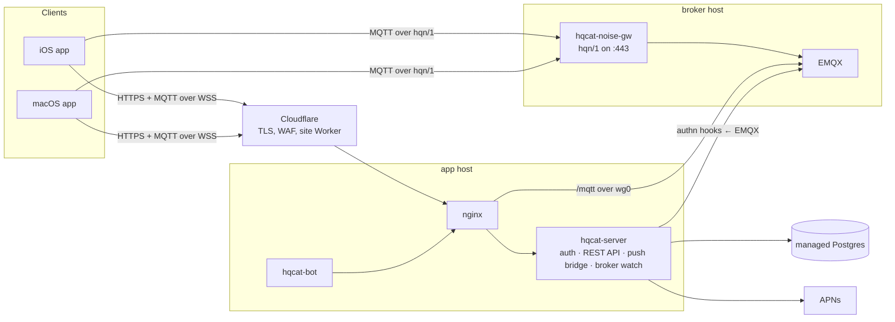

# Architecture overview

HQChat is an end-to-end encrypted messenger with post-quantum key agreement
(HQC-256). The server authenticates clients, keeps the friend graph and moves
ciphertext; it never holds a key that opens a message.

## Components

| Component | Role |
|---|---|
| **Apple apps** (`apps/apple`) | One SwiftUI codebase, two targets, on the Rust core (`core/`, through uniffi): the core speaks the protocol and seals what is stored; the app keeps the UI, the sockets, TLS pinning, push and the Secure Enclave vault |
| **Site** (`apps/site`) | A Cloudflare Worker serving the marketing, crypto and legal pages |
| **hqcat-server** (`services/server/src/server`) | One process: `/auth/*` sign-in, the REST API, EMQX's authentication hooks, the push bridge (wakes offline devices through APNs), the broker watch (health checks and expired-row sweeps), `/health` |
| **hqcat-noise-gw** (`src/gateway`) | Terminates hqn/1, a post-quantum Noise transport, and pipes the decrypted MQTT stream to EMQX |
| **hqcat-bot** (`src/bot`) | The helper account every new user is befriended to; runs the Rust core's client `Engine`, the one the apps link |
| **EMQX** | The MQTT broker. Every client CONNECT is checked by the server; a static file ACL is the whole topic policy |
| **Postgres** | Accounts, the friend graph, prekeys, push tokens, sessions, reports. A managed DigitalOcean cluster |

The protocol lives in the Rust core (`core/`: identity, frames, the double
ratchet, the handshake, the CONNECT proof, hqn/1, MQTT, HQC) and so does the
client (`hqchat-engine`): the apps link it through uniffi, and the server, the
gateway and the bot load it as a Node addon. The TS implementation the server
used before is kept in `services/server/test/reference/` as an independent one
for testing; shared vector files pin the two byte for byte
([multiplatform.md](multiplatform.md), [core-wiring.md](core-wiring.md)).

## Hosts

Each environment (`infra/environments/<name>.json`) is two droplets from one
NixOS image (three where it sizes a sim node), a VPC, a managed database and
Cloudflare records:

| Host | Public | Private (WireGuard) |
|---|---|---|
| **app** | 80/443 from Cloudflare only (TLS 1.3, hybrid X25519MLKEM768); SSH, rate-limited per source and optionally limited to `adminSshSources` | nginx → hqcat-server on 8090; the bot |
| **mqtt** (broker) | 443 (hqn/1); SSH from the app host only | EMQX WebSocket 8083, internal listener 1884, admin API 18083; gateway keys on 8081 |
| **sim** (where `sizes.sim` is set) | SSH as the app host; no service port. Reaches the service at its public addresses, like a phone | none; only its own database pool in the VPC ([sim runbook](../runbooks/sim.md)) |

The app and broker hosts reach each other only over WireGuard (with a preshared key)
inside the VPC, and reach out only on the ports they use. Each host learns its
role and addresses at boot from the DigitalOcean metadata service. SSH accepts
only hybrid post-quantum key exchange; EMQX's Erlang distribution is bound to
loopback.

## Data at a glance

| Data | Where | Readable by the server |
|---|---|---|
| Messages | devices; ciphertext through EMQX | no |
| Private keys | sealed by the core on the device, under the Secure Enclave key and a Keychain state secret | no |
| Public keys, handles, the graph | Postgres | yes |
| Presence | EMQX, retained | yes |
| Report excerpts | Postgres, 90 days | yes, by design |
| Crash reports | Sentry, from the apps and the server; no traffic, spans, replay or install id | yes |

See [e2ee-protocol.md](e2ee-protocol.md) for the cryptography,
[auth-flow.md](auth-flow.md) for sign-in, [message-flow.md](message-flow.md)
for a message end to end, [transport.md](transport.md) for the transports and
the broker, and [emqx-acl.md](emqx-acl.md) for the topic policy.

## Delivery

One **Deploy** workflow (`.github/workflows/deploy.yml`) takes an environment
from nothing to a verified release: CI, a Nix build of each host's closure and
the disk image, Terraform, encrypted secret bundles, a channel move that hosts
pull within two minutes, and a verification that runs the functional scenarios
against the live environment, rolling back on failure. Hosts are never
configured by hand. See [the deploy runbook](../runbooks/deploy.md).

## Repository map

| Path | Contents |
|---|---|
| `apps/apple/` | Xcode project, the shared `HQChat/` sources, `HQChat iOS/`, `CoreShell/` (the package that carries out the engine's effects), test slices (`tests/`, `e2e/`, `fuzz/`), `verify.sh`, `release.sh` |
| `apps/site/` | The Worker and its tests |
| `core/` | The Rust core: `hqc-sys`, `hqc`, `hqchat-protocol`, `hqchat-engine`, `hqchat-node` (napi), `hqchat-ffi` (uniffi), `hqchat-verdict` (fuzzing), and the generated Swift package `swift/HQChatCore` |
| `services/server/` | `src/{server,gateway,bot,common}`, operator `scripts/`, `test/{unit,integration,scenarios,fuzz,reference}` |
| `native/hqc/` | The HQC-256 wrapper, built from a pinned upstream commit into the Rust core (`hqc-sys`) on every platform, and as a standalone Nix package with its self-test |
| `infra/environments/` | One JSON file per environment |
| `infra/terraform/` | The single Terraform root |
| `infra/nixos/` | Host modules, the host agent, the two-VM stack test |
| `infra/emqx/` | Broker configuration and ACL |
| `infra/scripts/` | Deploy steps: Terraform wrapper and guard, secret publishing, release, environment bootstrap |
| `scripts/` | `check.sh` (every test and lint layer), `lint-text.sh`, `compute-spki-pins.sh` |
| `.github/workflows/` | `ci.yml`, `scan.yml` (gitleaks, npm audit, cargo deny), `codeql.yml`, `deploy.yml`, `apple-release.yml`, `app-store.yml`, `hqc-upstream.yml` (weekly notice when the pinned HQC upstream moves) |
