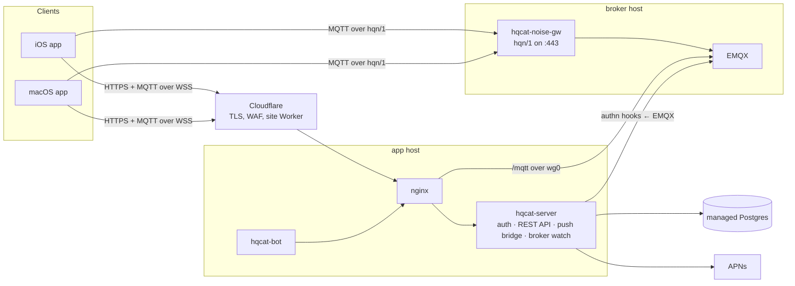

# Architecture overview

HQChat is an end-to-end encrypted messenger with post-quantum key agreement
(HQC-256). The server authenticates clients, keeps the friend graph and moves
ciphertext; it never holds a key that opens a message.

## Components

| Component | Role |
|---|---|
| **Apple apps** (`apps/apple`) | One SwiftUI codebase, two targets. Hold every private key; seal stored messages with a Secure Enclave key |
| **Site** (`apps/site`) | A Cloudflare Worker serving the marketing, crypto and legal pages |
| **hqcat-server** (`services/server/src/server`) | One process: `/auth/*` sign-in, the REST API, EMQX's authentication hooks, the push bridge (wakes offline devices through APNs), the broker watch (health checks and expired-row sweeps), `/health` |
| **hqcat-noise-gw** (`src/gateway`) | Terminates hqn/1, a post-quantum Noise transport, and pipes the decrypted MQTT stream to EMQX |
| **hqcat-bot** (`src/bot`) | The helper account every new user is befriended to; runs the Rust core's client `Engine`, the one the apps link |
| **EMQX** | The MQTT broker. Every client CONNECT is checked by the server; a static file ACL is the whole topic policy |
| **Postgres** | Accounts, the friend graph, prekeys, push tokens, sessions, reports. A managed DigitalOcean cluster |

The protocol lives in the Rust core (`core/`: identity, frames, the double
ratchet, the handshake, the CONNECT proof, hqn/1, HQC), which the server, the
gateway and the bot load as a Node addon. The Swift app still has its own
implementation until phase 3 ([multiplatform.md](multiplatform.md)), and the
TS one the server used before is kept in `services/server/test/reference/` for
testing; shared vector files pin all three byte for byte.

## Hosts

Each environment (`infra/environments/<name>.json`) is two droplets from one
NixOS image, a VPC, a managed database and Cloudflare records:

| Host | Public | Private (WireGuard) |
|---|---|---|
| **app** | 80/443 from Cloudflare only; SSH | nginx → hqcat-server on 8090; the bot |
| **mqtt** (broker) | 443 (hqn/1); SSH from the app host only | EMQX WebSocket 8083, internal listener 1884, admin API 18083; gateway keys on 8081 |

The two hosts reach each other only over WireGuard inside the VPC. Each host
learns its role and addresses at boot from the DigitalOcean metadata service.

## Data at a glance

| Data | Where | Readable by the server |
|---|---|---|
| Messages | devices; ciphertext through EMQX | no |
| Private keys | device Keychain and Secure Enclave | no |
| Public keys, handles, the graph | Postgres | yes |
| Presence | EMQX, retained | yes |
| Report excerpts | Postgres, 90 days | yes, by design |

See [e2ee-protocol.md](e2ee-protocol.md) for the cryptography,
[auth-flow.md](auth-flow.md) for sign-in, [message-flow.md](message-flow.md)
for a message end to end, [transport.md](transport.md) for the transports and
the broker, and [emqx-acl.md](emqx-acl.md) for the topic policy.

## Delivery

One **Deploy** workflow (`.github/workflows/deploy.yml`) takes an environment
from nothing to a verified release: CI, a Nix build of both host closures and
the disk image, Terraform, encrypted secret bundles, a channel move that hosts
pull within two minutes, and a verification that runs the functional scenarios
against the live environment, rolling back on failure. Hosts are never
configured by hand. See [the deploy runbook](../runbooks/deploy.md).

## Repository map

| Path | Contents |
|---|---|
| `apps/apple/` | Xcode project, the shared `HQChat/` sources, `HQChat iOS/`, test slices (`tests/`, `e2e/`, `fuzz/`), `verify.sh` |
| `apps/site/` | The Worker and its tests |
| `services/server/` | `src/{server,protocol,common,client,bot,gateway}`, operator `scripts/`, `test/{unit,integration,scenarios,fuzz}` |
| `native/hqc/` | The HQC-256 wrapper, built from a pinned upstream commit for Linux (Nix) and Apple (`build-apple.sh`) |
| `infra/environments/` | One JSON file per environment |
| `infra/terraform/` | The single Terraform root |
| `infra/nixos/` | Host modules, the host agent, the two-VM stack test |
| `infra/emqx/` | Broker configuration and ACL |
| `infra/scripts/` | Deploy steps: Terraform wrapper and guard, secret publishing, release, environment bootstrap |
| `scripts/` | `check.sh` (every test and lint layer), `lint-text.sh`, `compute-spki-pins.sh` |
| `.github/workflows/` | `ci.yml`, `deploy.yml`, `hqc-upstream.yml` (weekly notice when the pinned HQC upstream moves) |
